# Personal CookBook

Dikemas kini: 2026-10-25 12:29 | Jumlah resepi: 17

## Senarai resepi

1. Mee Udang - ditambah 2026-10-06 20:26
2. Sandwic Telur Mayonis - ditambah 2026-10-06 21:07
3. Daging Goreng Kunyit dan Sambal Belacan - ditambah 2026-10-06 21:42
4. Kuey Teow Kantonis - ditambah 2026-10-07 00:15
5. Sup Daging Cara Orang Thailand - ditambah 2026-10-07 20:00
6. Donat Kentang Gebu dan Lembut - ditambah 2026-10-07 22:15
7. Kuih Bakar Pandan - ditambah 2026-10-07 22:21
8. Kuih Lopes Guna Rice Cooker dan Tanpa Kukus - ditambah 2026-10-07 22:50
9. Karipap Rangup Inti Keledek - ditambah 2026-10-07 22:58
10. Cucur Kembung Cicah Sambal Sardin - ditambah 2026-10-07 23:32
11. Kentang Rangup Bersalut Parmesan dan Roti Bakar Herba - ditambah 2026-10-08 06:14
12. Pho Vietnam - ditambah 2026-10-08 06:33 (langkah tiada)
13. Ayam Halia Thai (Gai Pad King) - ditambah 2026-10-08 07:33
14. Sambal Belimbing Buluh - ditambah 2026-10-09 00:02
15. Mee Celup Thai versi Akak Founder - ditambah 2026-10-10 14:18
16. Daging Masak Merah Cara Kedai Tomyam - ditambah 2026-10-10 14:29
17. Pisang Goreng Thailand dengan Sos Pisang - ditambah 2026-10-25 12:29

---

# Mee Udang

## Sumber dan asas catatan

- Pencipta: **Jia Le Woh** (Facebook; tanda pagar termasuk `#chefjia`).
- Pautan sumber: https://www.facebook.com/reel/1204449718462919
- Tarikh simpan: 6 Oktober 2026. Untuk kegunaan peribadi sahaja.
- Tempoh video: kira-kira **1 minit 39 saat**.
- Maklumat disusun daripada **kapsyen penuh, bingkai video dan transkripsi automatik audio**. Transkripsi automatik boleh tersalah mengeja; perkataan yang jelas sepadan dengan bahan dan paparan video diseragamkan kepada ejaan Bahasa Malaysia.
- Kuantiti berangka di bawah diambil daripada kapsyen, bukan dianggarkan daripada gambar. Bahan tambahan yang disebut dalam audio atau kelihatan dalam hidangan diasingkan dan ditandakan **[TIDAK DINYATAKAN]** apabila kuantitinya tidak diberikan.
- Bilangan hidangan: **[TIDAK DINYATAKAN]**.
- Masa penyediaan: **[TIDAK DINYATAKAN]**.
- Masa memasak keseluruhan: **[TIDAK DINYATAKAN]**. Audio menyebut memasak stok selama **1 jam**; ini bukan jumlah masa keseluruhan resipi.

## Bahan dan kuantiti

### A. Sambal — kuantiti dalam kapsyen

- Bawang putih — **20 g**.
- Udang kering — **30 g**.
- Cili boh — **300 g**; ditulis sebagai “Chili Boh” dalam kapsyen.
- Garam — **1/2 sudu teh**; kapsyen: `1/2Tsp`.
- Gula — **2 sudu teh**; kapsyen: `2Tsp`.

### B. Sambal — bahan tambahan dalam penerangan audio

- Bawang merah — **[TIDAK DINYATAKAN]**.
- Minyak untuk mengisar bahan sambal — **[TIDAK DINYATAKAN]**.
- Minyak untuk menumis sambal — **[TIDAK DINYATAKAN]**; audio menyebut “sedikit minyak”, tanpa ukuran.
- Belacan — **[TIDAK DINYATAKAN]**.

### C. Stok / sup udang

Bahan ini diterangkan dalam audio, tetapi kuantitinya tidak diberikan dalam kapsyen.

- Kulit udang — **[TIDAK DINYATAKAN]**. Jangan andaikan kuantitinya bersamaan dengan 100 g isi udang yang disenaraikan untuk hidangan.
- Minyak untuk menumis kulit udang — **[TIDAK DINYATAKAN]**.
- Air — **[TIDAK DINYATAKAN]**.
- Tulang ayam — **[TIDAK DINYATAKAN]**.
- Kaki ayam — **[TIDAK DINYATAKAN]**.
- Sengkuang — **[TIDAK DINYATAKAN]**.
- Sambal yang telah dimasak — **separuh daripada sambal yang disediakan**, mengikut penerangan audio; berat atau isipadu: **[TIDAK DINYATAKAN]**.
- Garam tambahan untuk sup — **[TIDAK DINYATAKAN]**.
- Gula tambahan untuk sup — **[TIDAK DINYATAKAN]**.

**Nota penting:** Kuantiti garam 1/2 sudu teh dan gula 2 sudu teh dalam kapsyen diletakkan di bawah bahagian sambal. Jangan gunakan angka itu sebagai ukuran tambahan untuk sup tanpa pengesahan sumber.

### D. Mee, bihun dan pelengkap

Kuantiti daripada bahagian “Bahan-Bahan Lain” dalam kapsyen:

- Bihun — **200 g**; kapsyen: “Bee Hoon”.
- Mee — **200 g**.
- Tauge — **80 g**; kapsyen: “Taugeh”.
- Kangkung — **30 g**.
- Udang — **100 g**.
- Bawang goreng — **[TIDAK DINYATAKAN]**.

Pelengkap tambahan yang disebut dalam audio / kelihatan dalam hidangan:

- Telur rebus — **[TIDAK DINYATAKAN]**. Cara dan tempoh merebus telur tidak diterangkan.
- Kek ikan / fish cake — **[TIDAK DINYATAKAN]**.
- Sambal untuk dihidangkan bersama — baki sambal yang disediakan; kuantiti setiap hidangan: **[TIDAK DINYATAKAN]**.

**Keadaan bahan:** Sama ada berat mee dan bihun merujuk kepada bahan kering, mentah atau selepas direbus ialah **[TIDAK DINYATAKAN]**. Audio menyebut menggunakan mee dan bihun yang telah direbus semasa menghidang. Cara menyediakan tauge dan kangkung sebelum dihidangkan: **[TIDAK DINYATAKAN]**.

## Langkah memasak

Urutan di bawah mengikut bahagian memasak dalam reel. Bahagian awal video ialah paparan hidangan siap, bukan permulaan langkah memasak.

### 1. Sediakan stok udang (sekitar 00:16–00:29)

1. Masukkan minyak dan kulit udang ke dalam periuk.
2. Tumis kulit udang sehingga wangi dan rangup, seperti disebut dalam penerangan audio.
3. Masukkan air, tulang ayam, kaki ayam dan sengkuang.
4. Biarkan stok masak selama **1 jam**.
5. Sukatan air, tahap api dan sama ada periuk ditutup sepanjang memasak: **[TIDAK DINYATAKAN]**.

### 2. Kisar bahan sambal (sekitar 00:42–00:49)

1. Masukkan udang kering, bawang putih, bawang merah dan minyak ke dalam pengisar.
2. Kisar sehingga halus.
3. Sama ada udang kering direndam terlebih dahulu: **[TIDAK DINYATAKAN]**.

### 3. Masak sambal (sekitar 00:49–01:10)

1. Masukkan sedikit minyak dan belacan ke dalam periuk; tumis.
2. Masukkan pes bahan yang telah dikisar.
3. Tumis sehingga wangi.
4. Masukkan cili boh.
5. Teruskan menumis sehingga **pecah minyak**.
6. Masukkan garam dan gula, kemudian masak dan kacau sehingga sebati.
7. Tempoh menumis, tahap api dan sukatan belacan: **[TIDAK DINYATAKAN]**.

**Nota ketepatan audio:** Transkripsi automatik sekitar 01:03–01:07 tidak cukup jelas pada frasa sebelum “garam dengan gula”. Oleh itu, tiada penambahan belacan kali kedua dicatatkan sebagai langkah pasti. Belacan pada permulaan tumisan disebut lebih jelas dan kelihatan dimasukkan ke dalam periuk.

### 4. Siapkan sup (sekitar 01:10–01:20)

1. Tapis stok yang telah dimasak.
2. Masukkan **separuh sambal** yang telah disediakan ke dalam stok.
3. Masukkan garam dan gula untuk sup; kuantiti kedua-duanya **[TIDAK DINYATAKAN]**.
4. Kacau dan masak sehingga sebati.

### 5. Masak udang (sekitar 01:20–01:25)

1. Rebus udang di dalam sup sehingga masak.
2. Video menunjukkan udang dimasukkan menggunakan penapis berjaring yang dicelup ke dalam sup.
3. Tempoh merebus udang: **[TIDAK DINYATAKAN]**.

### 6. Susun dan hidangkan (sekitar 01:25–01:39)

1. Masukkan mee dan bihun yang telah direbus ke dalam mangkuk atau pinggan hidangan.
2. Tambahkan telur rebus, kek ikan, tauge, kangkung dan udang.
3. Tuangkan sup udang.
4. Akhir sekali, taburkan bawang goreng dan hidangkan bersama sambal.
5. Tempoh merebus mee dan bihun serta kuantiti setiap bahan untuk satu hidangan: **[TIDAK DINYATAKAN]**.

## Petua dan perkara penting daripada video

- **Tumis kulit udang sehingga wangi dan rangup** sebelum memasukkan air dan bahan stok.
- **Masak stok selama 1 jam**, mengikut penerangan sumber.
- **Kisar bahan sambal sehingga halus**.
- **Tumis pes sehingga wangi**, kemudian tumis cili boh sehingga **pecah minyak**.
- **Tapis stok** sebelum menambah sambal dan menyiapkan sup.
- **Masukkan separuh sambal ke dalam sup**; sambal juga dihidangkan bersama hidangan pada akhir video.
- **Rebus udang dalam sup sehingga masak**, seperti langkah yang ditunjukkan.
- Pembukaan video menyebut rasa sup yang kaya dengan umami udang serta mee dan bihun yang menyerap sup. Hidangan dicadangkan untuk perjumpaan Tahun Baharu Cina, dengan penyediaan menggunakan satu periuk.
- Tiada petua penyimpanan, tempoh tahan sambal, penggantian bahan atau sukatan air diberikan: **[TIDAK DINYATAKAN]**.

## Peralatan dan segmen promosi (sekitar 00:29–00:42)

- Peralatan yang kelihatan: periuk, pengisar, sudip, senduk dan penapis berjaring.
- Video mempromosikan periuk **Jaya Mata** dengan label **SUS304 Stainless Steel** dan **5 Layer Composite Base** pada pembungkusan.
- Penerangan menyebut ketahanan, tahan panas dan mudah dibersihkan. Ini ialah **dakwaan promosi dalam sumber**, bukan penilaian bebas.
- Pembungkusan turut menunjukkan nama “Covered Saucepan” dan “Covered Casserole”. Saiz periuk yang diperlukan untuk resipi: **[TIDAK DINYATAKAN]**.

## Lima gambar penting

Gambar diambil terus daripada bingkai reel tanpa tindihan antara muka Facebook. Masa ialah kedudukan dalam video, bukan tempoh memasak.

### 1. Menumis kulit udang — 00:21

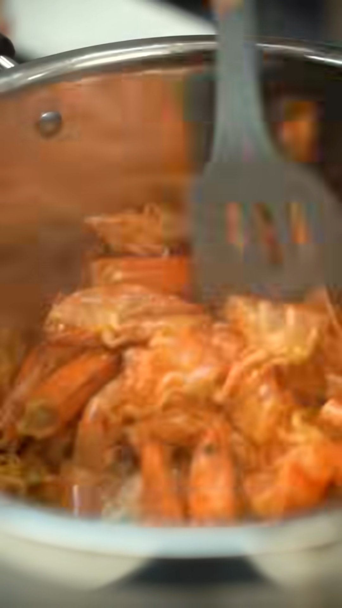

### 2. Mengisar bahan sambal — 00:48


### 3. Sambal pecah minyak — 01:06

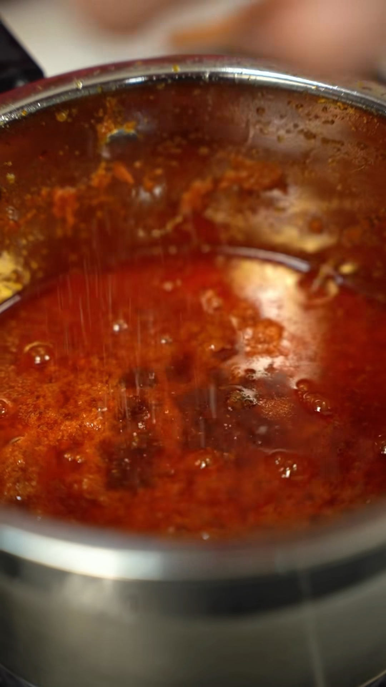

### 4. Merebus udang dalam sup — 01:21

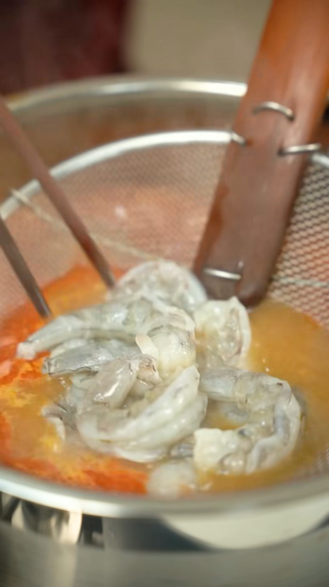

### 5. Hidangan siap bersama sambal — 01:36

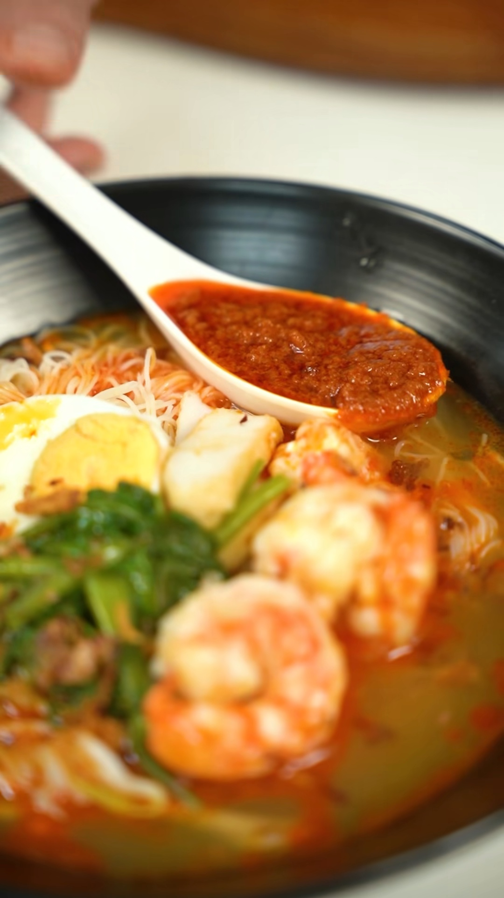

## Kapsyen bahan asal untuk semakan

Bahagian bahan dalam kapsyen sumber ditranskripsikan di bawah; ejaan dan unit asal dikekalkan:

```text
Bahan-bahan （Sambal）
Bawang Putih 20g
Udang Kering 30g
Chili Boh 300g
Garam 1/2Tsp
Gula 2Tsp
Bahan-Bahan Lain
Bee Hoon -200g
Mee - 200g
Taugeh -80g
Kangkung -30g
Bawang Goreng
Udang -100g
```

**Ringkasan batas maklumat:** Kapsyen tidak menyenaraikan semua bahan yang diterangkan dalam audio. Kuantiti bahan stok, bawang merah, minyak, belacan, telur, kek ikan serta garam dan gula tambahan untuk sup tidak diberikan. Semua kekurangan tersebut ditandakan **[TIDAK DINYATAKAN]**, tanpa meneka sukatan.


---

# Sandwic Telur Mayonis

## Sumber
- Pautan: https://www.youtube.com/watch?v=iSET-kSvGmY
- Pembuat: zid-k, KasiTapau Channel
- Tarikh simpan: 6 Oktober 2026
- Bahan, langkah dan petua diambil daripada sari kata Bahasa Melayu yang disediakan untuk video sumber, bukan daripada huraian video sahaja. Huraian video tidak mengandungi senarai bahan atau langkah lengkap.
- Tiada trek bertanda `-orig` dalam senarai sari kata. Satu trek Bahasa Melayu yang disenaraikan sebagai sari kata tersedia (bukan terjemahan automatik) digunakan.
- Untuk kegunaan peribadi sahaja.

## Bahan
- Telur: 5 biji.
- Mayonis: [TIDAK DINYATAKAN] — tambah sedikit demi sedikit sehingga campuran telur menjadi lembik; tambah lagi jika perlu.
- Lada sulah: sedikit; sukatan tepat [TIDAK DINYATAKAN].
- Garam untuk inti: secubit.
- Roti: [TIDAK DINYATAKAN] — bilangan keseluruhan keping tidak disebut.

### Untuk merebus dan menyejukkan telur
- Air untuk merebus: [TIDAK DINYATAKAN].
- Minyak: sedikit; sukatan tepat [TIDAK DINYATAKAN].
- Garam dalam air rebusan: sedikit; sukatan tepat [TIDAK DINYATAKAN].
- Air sejuk: [TIDAK DINYATAKAN].

## Langkah
1. Didihkan air dalam periuk. Masukkan 5 biji telur dan rebus selama 10 minit. Masukkan juga sedikit minyak dan garam ke dalam air rebusan.
2. Selepas 10 minit, keluarkan telur dan terus masukkan ke dalam air sejuk. Kupas kulit telur.
3. Hancurkan telur menggunakan garpu.
4. Masukkan mayonis sedikit demi sedikit dan gaul sebati sehingga campuran kelihatan lembik. Tambah lagi mayonis jika perlu.
5. Masukkan sedikit lada sulah dan secubit garam. Gaul sebati.
6. Letakkan inti telur mayonis di atas sekeping roti, kemudian tutup dengan sekeping roti lagi.
7. Potong bahagian tepi roti. Video menunjukkan sandwic dipotong menjadi bentuk segi tiga. Pemotongan boleh ditinggalkan; menurut pembuat, ia hanya untuk mencantikkan hidangan.

## Petua
- Menurut pembuat, sedikit minyak dan garam dalam air rebusan membantu memudahkan kulit telur ditanggalkan dan mengelakkan telur melekat pada kulit.
- Masukkan mayonis beransur-ansur supaya boleh menyesuaikan kelembutan inti seperti yang dinyatakan dalam sari kata.
- Sesuai dijadikan sarapan, minum petang atau bekal anak ke sekolah, menurut pembuat.

## Maklumat yang tidak lengkap
- Sukatan tepat mayonis, lada sulah, minyak, garam untuk rebusan dan air: [TIDAK DINYATAKAN].
- Bilangan keseluruhan keping roti dan bilangan hidangan: [TIDAK DINYATAKAN].
- Kuantiti tidak dianggarkan daripada saiz sudu atau rupa bahan dalam gambar.

## Gambar
Bingkai diambil daripada video sumber. Masa merujuk kepada kedudukan dalam video.

### Telur direbus — 01:10


### Telur dihancurkan — 02:10
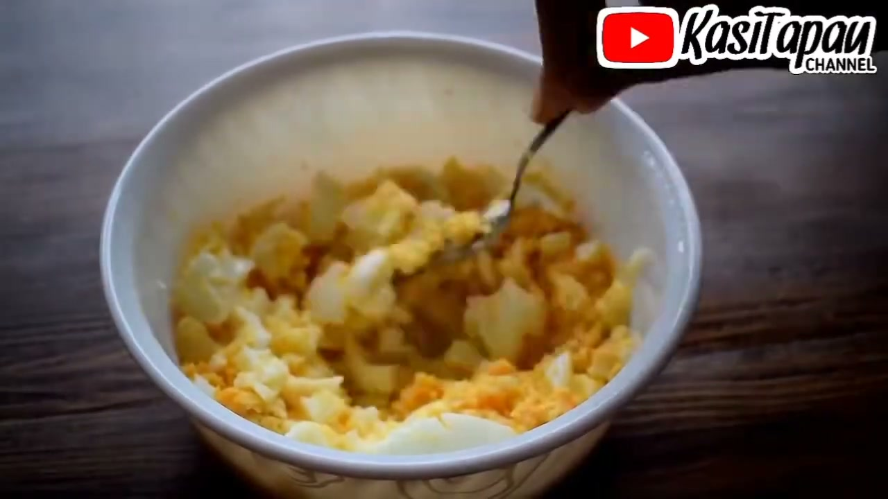

### Inti telur mayonis di atas roti — 03:30


### Sandwic siap — 04:50


---

# Daging Goreng Kunyit dan Sambal Belacan

Sumber: https://www.youtube.com/watch?v=FKwT4UghZT0
Pembuat: Che Nom
Tarikh disimpan: 2026-10-06
Jenis: Resipi
Bahasa audio: Bahasa Melayu (ms)
Transkrip audio: Digunakan; transkrip automatik boleh tersalah dengar.

## Bahan

### Daging goreng kunyit
- Daging lembu: 350 g.
- Soda penaik (baking soda), untuk perapan: 1/2 sudu kecil.
- Air untuk perapan: sehingga daging tenggelam.
- Garam: sedikit.
- Minyak masak: 1/4 cawan.
- Serbuk kunyit: 1–2 sudu kecil.
- Bawang putih: 3 ulas.
- Halia: 1/2 inci.
- Sos tiram: 1 sudu besar.
- Kacang panjang: [TIDAK DINYATAKAN] kuantitinya; pilihan menurut audio.
- Bawang besar: 1/2 biji; audio menyebut bawang Holland.
- Cili padi: 8–10 tangkai.
- Air untuk merebus dan melembapkan masakan: sehingga agak menenggelami daging ketika merebus; tambahan akhir jika perlu [TIDAK DINYATAKAN] kuantiti tepat. Maklumat daripada audio.

### Sambal belacan
- Cili padi: 10 tangkai.
- Cili merah besar: 2–3 biji.
- Limau kasturi: 3 biji.
- Belacan: sebesar ibu jari.
- Air asam jawa: 1/2 cawan.
- Garam: 1 sudu kecil.
- Gula: 1/2 sudu besar.
- Serbuk perasa: jika suka; [TIDAK DINYATAKAN] kuantitinya.
- Sos ikan: pilihan yang disebut digunakan dalam audio; [TIDAK DINYATAKAN] kuantitinya.

## Langkah

### Penyediaan dan perapan daging
1. Hiris daging melawan arah urat. Audio menyebut ketebalan kira-kira 1/2 cm [SEMAK — ukuran hanya daripada transkrip audio].
2. Gaulkan daging dengan soda penaik, tambah air sehingga tenggelam dan perap selama 15 minit [SEMAK — tempoh hanya daripada transkrip audio]. Gunakan sukatan bahan dalam kapsyen, iaitu 350 g daging dan 1/2 sudu kecil soda penaik.
3. Sementara menunggu, hiris bawang besar sederhana nipis, cincang kasar bawang putih dan hiris halia halus memanjang. Sediakan kacang panjang; ukuran potongan [TIDAK DINYATAKAN]. Buang tangkai cili padi dan belah dua atau ketuk sedikit [SEMAK — ungkapan pada transkrip kurang jelas].

### Sambal belacan
4. Potong bahagian tangkai keras limau kasturi, belah dua dan buang semua bijinya. Limau akan dikisar bersama sambal.
5. Buang tangkai cili padi dan sediakan cili merah besar.
6. Cucuk belacan pada garpu, bilas sedikit dan bakar di atas api dapur sehingga wangi serta masak hingga ke bahagian dalam. Tempoh membakar [TIDAK DINYATAKAN].
7. Bancuh asam jawa dengan air masak untuk menyediakan air asam jawa mengikut sukatan bahan.
8. Masukkan potongan limau, cili, air asam jawa, belacan bakar, gula dan garam ke dalam pengisar. Kisar seketika; jangan terlalu halus.
9. Tambah serbuk perasa jika suka. Dalam audio, Che Nom menyebut menggunakan sos ikan; kuantitinya [TIDAK DINYATAKAN].

### Memasak daging goreng kunyit
10. Selepas perapan, bilas daging sehingga kesan soda penaik hilang dan toskan. Gaulkan dengan serbuk kunyit dan garam.
11. Masukkan daging ke dalam kuali sebelum menyalakan api. Tuang air sehingga agak menenggelami daging, kemudian masak bertutup menggunakan api sederhana sehingga air kering.
12. Periksa kelembutan daging. Jika masih liat, tambah air dan rebus lagi. Tempoh merebus [TIDAK DINYATAKAN].
13. Apabila air kering dan daging lembut, masukkan minyak masak. Gaul dan goreng daging hingga sebati.
14. Tambah bawang putih dan halia, kemudian sos tiram. Audio turut menyebut tambahan serbuk kunyit untuk warna yang lebih kuning; kuantiti tambahan [TIDAK DINYATAKAN].
15. Masukkan kacang panjang dan bawang besar. Goreng bersama daging, kemudian masukkan cili padi pada akhir masakan.
16. Jika terlalu kering, tambah sedikit air. Audio menyebut sesuatu seperti “dua–tiga sudu” [SEMAK — kuantiti hanya daripada audio dan jenis sudu tidak jelas].
17. Hidangkan bersama sambal belacan. Audio mencadangkan nasi panas dan kicap sebagai iringan; kuantiti [TIDAK DINYATAKAN].

## Petua
- Hiris daging melawan arah urat.
- Bilas daging selepas perapan soda penaik; jangan abaikan langkah ini.
- Gunakan api sederhana ketika merebus; tambah air dan teruskan rebusan jika daging belum lembut.
- Buang semua biji limau sebelum mengisar sambal untuk mengelakkan rasa pahit, menurut penerangan pembuat.
- Cili merah besar dicampurkan dalam sambal untuk mengurangkan kepedasan, menurut audio.
- Kacang panjang ialah pilihan. Audio menyebut kapsikum sebagai alternatif; kuantiti [TIDAK DINYATAKAN].
- Audio menyebut jus limau atau lemon sebagai alternatif bahan perapan; kuantiti dan kaedah lengkap [TIDAK DINYATAKAN]. Resipi ini menggunakan soda penaik seperti kapsyen.

## Catatan semakan
- Kapsyen diutamakan: 350 g daging dan 1/2 sudu kecil soda penaik. Audio pula menyebut panduan 1% berat daging, dengan contoh 300 g daging dan 3 g soda penaik [SEMAK — contoh audio berbeza daripada sukatan kapsyen; tidak digunakan untuk menggantikan kapsyen].
- Senarai Bahasa Melayu menyebut kacang panjang, manakala senarai Bahasa Inggeris menyebut “green beans” [SEMAK — nama sayur berbeza; senarai Bahasa Melayu diutamakan].
- Istilah bahagian daging dalam transkrip tidak jelas (“nakel”) [SEMAK]; tiada bahagian khusus ditetapkan dalam senarai bahan.
- Tajuk sumber menyebut “15 minit”; ini tidak dianggap jumlah masa memasak. Tempoh perapan 15 minit diambil daripada audio dan ditandakan untuk semakan.
- Sari kata tidak tersedia. Langkah diolah daripada transkrip audio Bahasa Melayu.
- Kuantiti kacang panjang, serbuk perasa, sos ikan, air tambahan dan kunyit tambahan serta tempoh merebus/membakar tidak dinyatakan dengan lengkap.
- Gambar ditangkap mengikut selang masa video, bukan dipilih mengikut kandungan. Nama fail bingkai dikekalkan seperti hasil skrip; cap masa tepat tidak dibekalkan.

## Gambar

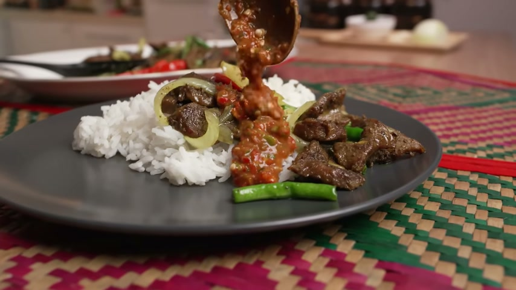
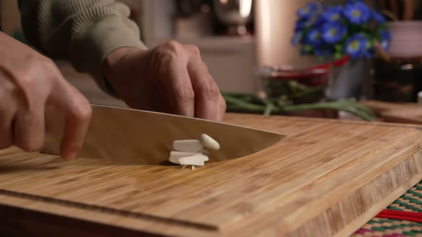
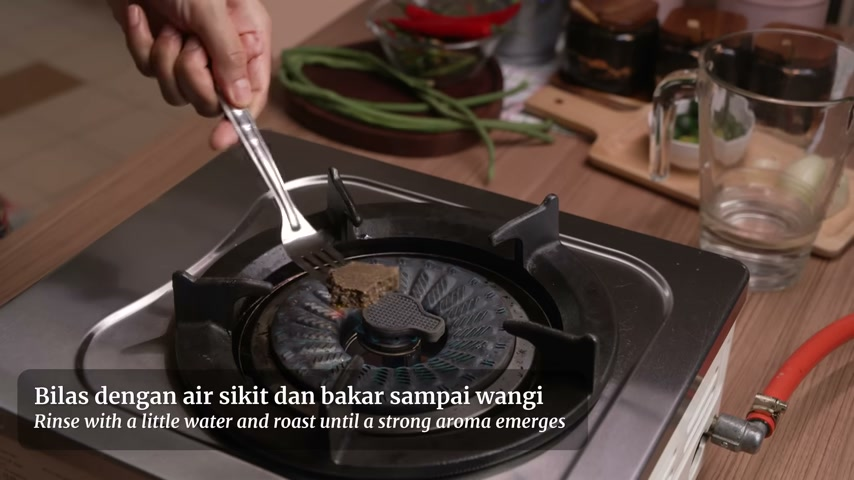
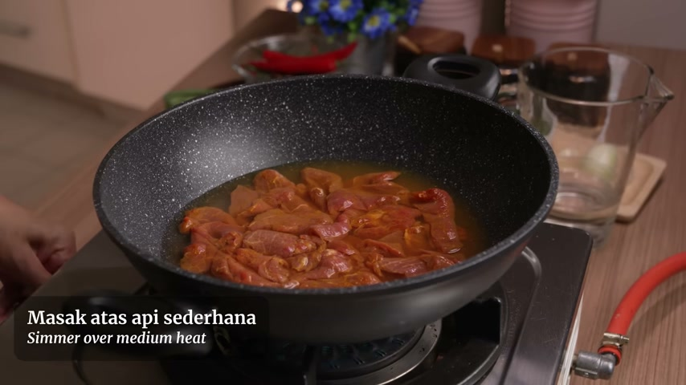
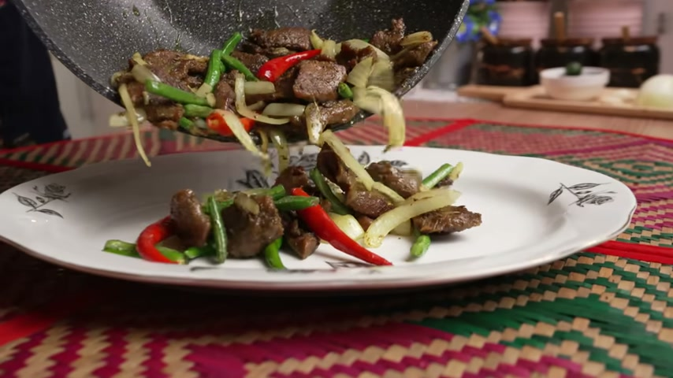


---

# Kuey Teow Kantonis

Sumber: https://www.facebook.com/share/v/19htKfqTpM/
Pautan video dikenal pasti: https://m.facebook.com/watch/?v=960450336994349&_rdr
Pembuat: Jia Le Woh
Tarikh disimpan: 2026-10-07
Jenis: Resipi
Bahasa audio: Bahasa Melayu (ms), seperti dikenal pasti oleh skrip.
Transkrip audio: Digunakan secara terhad; transkrip automatik hanya sampai kira-kira saat ke-37 daripada video 107 saat. Sari kata tidak tersedia.

## Bahan

### Bahan utama daripada kapsyen
- Kuey teow: 350 g.
- Sayur: 80 g; jenis sayur [TIDAK DINYATAKAN].
- Ayam: 80 g; bahagian dan potongan [TIDAK DINYATAKAN].
- Udang: 80 g.
- Bawang putih: 10 g.
- Telur: sebiji.

### Perasa daripada kapsyen
- Garam: 2 sudu kecil (2 Tsp).
- Kicap cair: 1 sudu besar (1 Tbsp).
- Serbuk ayam: 1 sudu kecil (1 Tsp).
- Lada putih: sedikit.

### Sebutan tambahan dalam transkrip audio
- Minyak: sedikit [SEMAK — transkrip sekitar 00:32 tidak jelas; jenis minyak dan kuantiti tepat TIDAK DINYATAKAN].

## Langkah

1. [SEMAK] Transkrip sekitar 00:32 mengandungi sebutan yang mungkin bermaksud memanaskan kuali dan menambah sedikit minyak. Ayat transkrip tidak jelas; ini bukan arahan yang telah disahkan.
2. [TIDAK DINYATAKAN] Urutan memasak kuey teow, bahan kuah, cara memasukkan telur, tempoh memasak dan langkah seterusnya tidak dapat dipastikan daripada maklumat yang diperoleh. Kapsyen hanya menyenaraikan bahan dan perasa; transkrip tidak meliputi keseluruhan video. Jangan anggap senarai ini sebagai kaedah memasak lengkap.

## Petua

[TIDAK DINYATAKAN] Tiada petua memasak yang jelas dalam kapsyen atau transkrip yang diperoleh. Gurauan dan nyanyian tidak dijadikan petua atau arahan memasak.

## Catatan semakan

- Semua sukatan bahan utama dan perasa diambil daripada kapsyen, bukan dianggarkan daripada gambar.
- Transkrip audio Bahasa Melayu tersedia tetapi tidak lengkap: hanya sampai kira-kira saat ke-37 bagi video 107 saat.
- Sebutan minyak dan kemungkinan arahan memanaskan kuali ditandakan [SEMAK] kerana transkrip tidak jelas.
- Jenis sayur, bahagian/potongan ayam, jenis dan kuantiti tepat minyak, kaedah memasak lengkap, tempoh memasak dan petua ditandakan [TIDAK DINYATAKAN].
- Bahan kuah lain tidak ditambah kerana tidak dinyatakan dalam kapsyen atau transkrip yang diperoleh.
- Gambar ditangkap mengikut selang masa video, bukan dipilih mengikut kandungan. Cap masa tepat setiap gambar tidak dibekalkan oleh skrip.
- Untuk kegunaan peribadi sahaja. Langkah boleh dilengkapkan jika teks atau kapsyen tambahan dibekalkan.

## Gambar


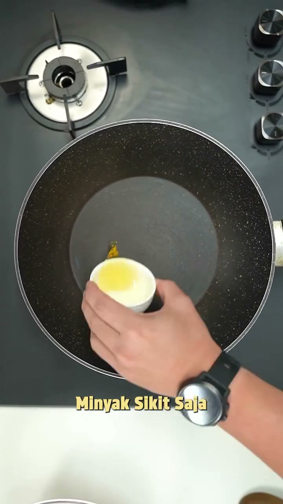
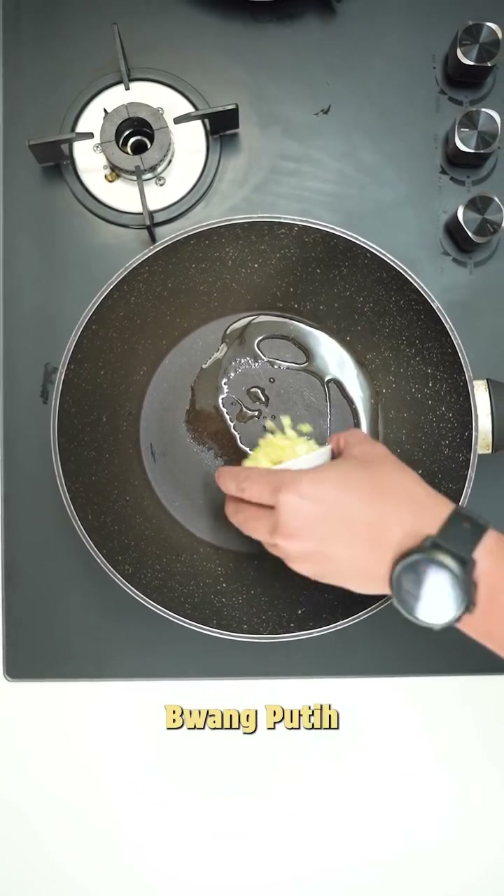
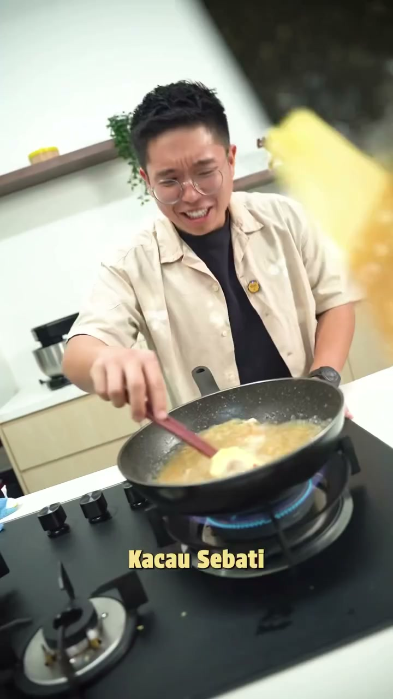
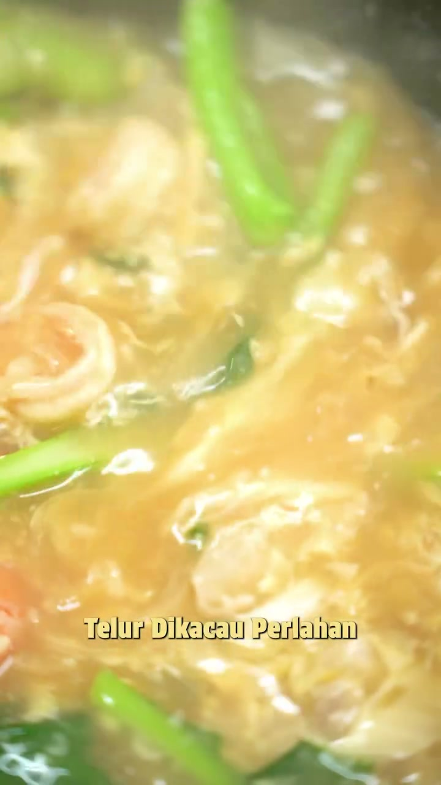


---

# Sup Daging Cara Orang Thailand

Sumber: https://www.facebook.com/share/v/1DcHioKVXZ/
Pautan video dikenal pasti: https://m.facebook.com/watch/?v=1464197558259674&_rdr
Pembuat: Yuwadee Akak Founder
Tarikh disimpan: 2026-10-07
Jenis: Resipi
Bahasa audio: Bahasa Melayu (ms), seperti dikenal pasti oleh skrip.
Transkrip audio: Digunakan; transkrip automatik sampai kira-kira saat ke-165 daripada video 166 saat. Sari kata tidak tersedia. Kapsyen hanya menyebut tajuk, tanpa senarai bahan atau langkah.

## Bahan

Semua butiran bahan berikut diolah daripada transkrip audio, bukan kapsyen. Nama yang kurang jelas ditandakan [SEMAK]; semua kuantiti yang hanya disebut dalam audio juga ditandakan [SEMAK].

### Sup
- Daging: kira-kira 1 kg lebih [SEMAK — kuantiti hanya daripada audio]; bahagian daging [TIDAK DINYATAKAN].
- Air rebusan: kira-kira 2 liter [SEMAK — kuantiti hanya daripada audio].
- Lengkuas: [TIDAK DINYATAKAN] kuantiti yang dapat dipastikan. Ada sebutan sebelum nama lengkuas yang mungkin merujuk bilangan atau bahan lain [SEMAK].
- Akar ketumbar: ditumbuk [SEMAK — transkrip berbunyi “agak ketumbang”]; kuantiti [TIDAK DINYATAKAN].
- Bawang putih: ditumbuk [SEMAK — nama bahan kurang jelas dalam transkrip]; kuantiti [TIDAK DINYATAKAN].
- Lada hitam: ditumbuk hingga hancur [SEMAK — transkrip berbunyi “dan hitam”]; kuantiti [TIDAK DINYATAKAN].
- Garam: [TIDAK DINYATAKAN] kuantitinya.
- “Kicap sotong”: satu senduk untuk sup, serta sedikit ketika menghidang [SEMAK — sukatan hanya daripada audio; jenis sos sebenar tidak dapat dipastikan]. Istilah audio dikekalkan dan tidak ditukar secara pasti kepada sos ikan atau kicap biasa.
- Ubi kentang: [TIDAK DINYATAKAN] kuantitinya.
- Bawang Holland: [TIDAK DINYATAKAN] kuantitinya.
- Tomato: [TIDAK DINYATAKAN] kuantitinya.

### Hidangan dan taburan
- Limau: [TIDAK DINYATAKAN] jenis dan kuantitinya.
- Cili kampung: ditumbuk sekadar pecah, bukan hingga hancur; [TIDAK DINYATAKAN] kuantitinya.
- Bawang goreng: [TIDAK DINYATAKAN] kuantitinya.
- Daun atau herba taburan: [SEMAK — nama tidak jelas pada transkrip sekitar 02:00]; jenis dan kuantiti [TIDAK DINYATAKAN].

## Langkah

1. Sediakan daging dan air rebusan mengikut sukatan yang disebut dalam audio. Masukkan lengkuas serta bahan aromatik yang ditumbuk. Nama akar ketumbar, bawang putih dan lada hitam masih perlu disemak seperti dalam senarai bahan.
2. Masukkan garam dan satu senduk “kicap sotong” [SEMAK — sukatan hanya daripada audio dan jenis sos belum pasti].
3. Cedok dan buang buih atau kotoran di permukaan rebusan. Pembuat menerangkan langkah ini untuk mendapatkan sup yang jernih.
4. Selepas membuang buih, tutup periuk dan tunggu kira-kira 30 minit [SEMAK — tempoh hanya daripada audio]. Tahap api [TIDAK DINYATAKAN].
5. Masukkan ubi kentang, bawang Holland dan tomato. Pada bahagian ini terdapat sebutan kurang jelas yang mengandungi “satu cawan” [SEMAK — bahan atau cecair yang dimaksudkan tidak dapat dipastikan; jangan tambah bahan berdasarkan andaian].
6. Tutup semula periuk dan tunggu kira-kira 10 minit [SEMAK — tempoh hanya daripada audio].
7. Sediakan limau untuk hidangan. Tumbuk cili kampung sekadar pecah; jangan tumbuk hingga hancur.
8. Pastikan daging sudah lembut. Pembuat menyebut jumlah masa memasak kira-kira satu jam [SEMAK — anggaran hanya daripada audio; tidak disamakan dengan jumlah dua tempoh menunggu yang disebut sebelumnya].
9. Untuk menghidang, masukkan cili yang ditumbuk ke dalam mangkuk dahulu, kemudian limau dan sedikit “kicap sotong” [SEMAK — jenis sos belum pasti]. Kuantiti setiap bahan hidangan [TIDAK DINYATAKAN].
10. Cedok sup bersama daging ke dalam mangkuk.
11. Taburkan bawang goreng. Ada sebutan daun atau herba taburan yang tidak jelas [SEMAK — jenis tidak dapat dipastikan].
12. Jika mahu lebih pedas, tambah cili lagi seperti cadangan pembuat. Kuantiti [TIDAK DINYATAKAN].

## Petua

- Rajin membuang buih atau kotoran di permukaan rebusan supaya sup jernih, menurut pembuat.
- Tumbuk cili sekadar pecah, bukan sehingga hancur.
- Cili dan limau dimasukkan ke dalam mangkuk ketika menghidang, kemudian sup dicedok ke atasnya.
- Pembuat menerangkan rasa yang dikehendaki sebagai masam, pedas dan masin. Sukatan pelarasan rasa [TIDAK DINYATAKAN].

## Catatan semakan

- Tiada sukatan dalam kapsyen. Semua kuantiti dalam resipi ini hanya daripada transkrip audio dan ditandakan [SEMAK].
- Nama akar ketumbar, bawang putih, lada hitam, “kicap sotong” dan daun/herba taburan perlu disemak kerana transkrip kurang jelas.
- Sebutan sebelum lengkuas dan sebutan “satu cawan” sekitar 00:54 tidak dapat dikenal pasti dengan yakin. Tiada bahan tambahan direka daripada sebutan ini.
- Kuantiti kebanyakan bahan, bahagian daging, jenis limau, kaedah potongan sayur, tahap api dan bilangan hidangan [TIDAK DINYATAKAN].
- Tempoh 30 minit, 10 minit dan anggaran keseluruhan satu jam ialah sebutan berasingan dalam audio. Jangan anggap dua tempoh pertama meliputi keseluruhan proses memasak.
- Gambar ditangkap mengikut selang masa video, bukan dipilih mengikut kandungan. Cap masa tepat setiap gambar tidak dibekalkan oleh skrip. Gambar tidak digunakan untuk menambah bahan atau langkah.
- Untuk kegunaan peribadi sahaja. Pautan sumber dan nama pembuat dikekalkan.

## Gambar

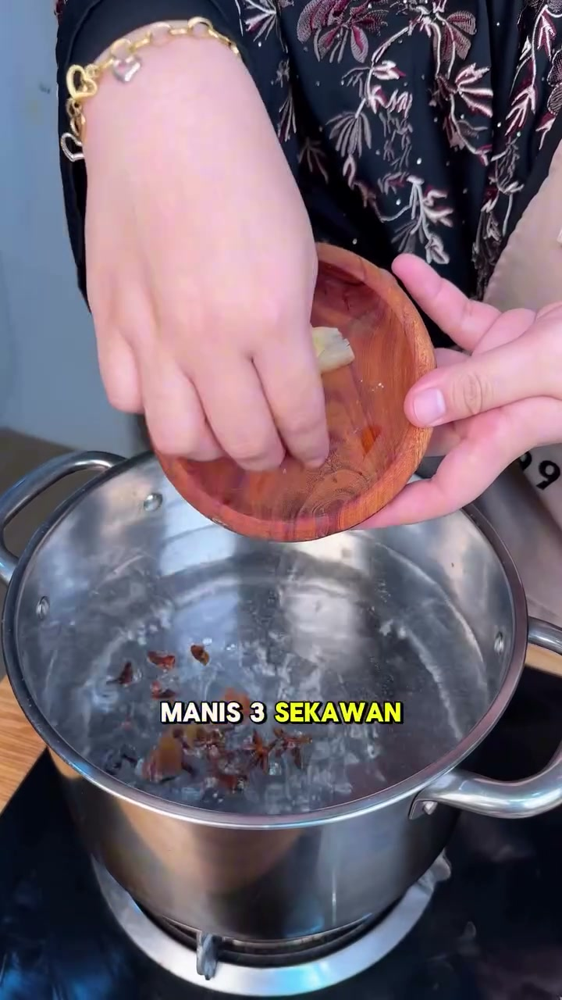
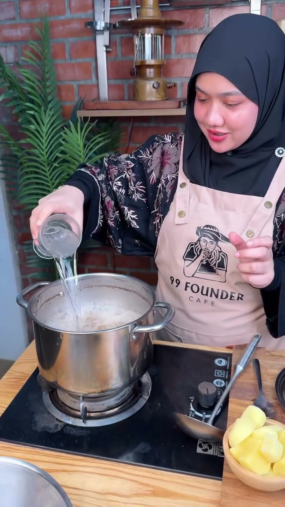
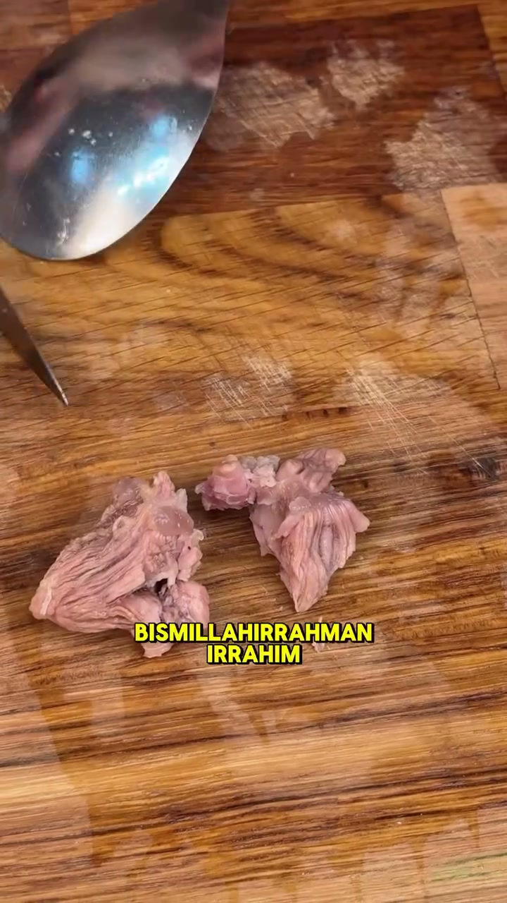
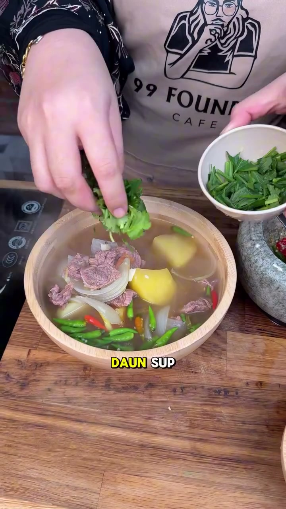
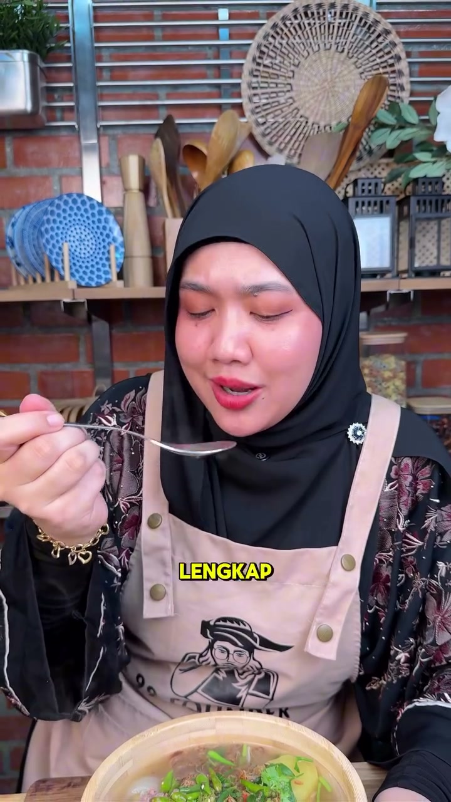


---

# Donat Kentang Gebu dan Lembut

Sumber: https://youtu.be/r4pV9FJzByY?si=RKuHCO9kko-OxZjr
Pautan video dikenal pasti: https://www.youtube.com/watch?v=r4pV9FJzByY
Pembuat: Che Nom
Tarikh disimpan: 2026-10-07
Jenis: Resipi
Bahasa audio: Bahasa Melayu (ms)
Transkrip audio: Digunakan; transkrip automatik sampai kira-kira saat ke-340 daripada video 341 saat. Sari kata tidak tersedia.

## Bahan

### Doh
- Kentang: 1 biji, anggaran 100 g.
- Tepung gandum atau tepung roti: 2 cawan / 250 g. Sukatan alternatif dikekalkan seperti kapsyen; tepung tambahan untuk menabur semasa menguli dan membentuk lubang [TIDAK DINYATAKAN] kuantitinya.
- Gula kastor: 1½ sudu besar.
- Garam: ½ sudu kecil.
- Yis segera: 1½ sudu kecil.
- Susu tepung: 2 sudu besar.
- Marjerin: 1½ sudu besar.
- Telur: 1 biji.
- Air sejuk dari peti ais: 80 ml; masukkan sedikit demi sedikit.

### Merebus, menggoreng dan menyalut
- Air untuk merebus kentang: [TIDAK DINYATAKAN] kuantitinya; langkah merebus disebut dalam audio.
- Minyak masak: [TIDAK DINYATAKAN] kuantitinya. Audio menyebut sedikit untuk menyapu mangkuk dan minyak yang banyak untuk menggoreng.
- Gula kastor untuk salutan: [TIDAK DINYATAKAN] kuantitinya.

## Langkah

1. Belah kentang kepada dua [SEMAK — bilangan potongan hanya daripada audio]. Rebus dengan air sehingga empuk; tempoh merebus [TIDAK DINYATAKAN].
2. Toskan kentang, biarkan air tersejat dan kentang sejuk. Kupas kulit, kemudian lenyek menggunakan garpu sehingga halus dan sekata.
3. Masukkan tepung gandum atau tepung roti ke dalam mangkuk. Tambah susu tepung, gula, garam dan yis. Ketika memasukkan bahan, letakkan yis jauh daripada garam supaya tidak bersentuhan secara langsung, seperti pesanan pembuat.
4. Tambah marjerin. Pecahkan telur, kacau hingga hancur dan masukkan ke dalam adunan.
5. Tuang air sejuk sedikit demi sedikit sehingga adunan menjadi doh. Masukkan kentang yang dilenyek, kemudian gaul dan uli hingga sekata.
6. Taburkan sedikit tepung pada permukaan kerja. Uli sehingga doh tidak melekat dan menjadi elastik. Jika menggunakan mesin pembuat roti (bread maker), pembuat menyebut semua bahan boleh dimasukkan untuk diuli; tetapan mesin [TIDAK DINYATAKAN].
7. Bulatkan doh. Sapu mangkuk dengan sedikit minyak, masukkan doh dan tutup menggunakan plastik pembalut makanan (cling wrap) atau tuala dapur bersih. Rehatkan sehingga doh naik dua kali ganda [SEMAK — tahap kenaikan hanya daripada audio]; tempoh menunggu [TIDAK DINYATAKAN].
8. Tekan doh untuk mengeluarkan gelembung udara, uli sedikit dan bulatkan semula. Bahagikan kepada 12 bahagian [SEMAK — bilangan hanya daripada audio]. Pembuat menyebut kira-kira 35–40 g bagi setiap doh kecil [SEMAK — berat hanya daripada audio]. Jika tidak menimbang, bahagikan supaya saiznya lebih kurang sama.
9. Bulatkan setiap doh kecil dan letakkan di atas potongan kertas pembakar supaya mudah dipindahkan ketika menggoreng. Sebagai pilihan, letakkan terus di atas dulang yang ditabur tepung.
10. Tekan sedikit supaya permukaan doh rata. Biarkan mengembang sedikit selama kira-kira 10–15 minit [SEMAK — tempoh hanya daripada audio]; pembuat berpesan jangan dibiarkan terlalu lama. Acuan donat juga boleh digunakan sebagai pilihan.
11. Panaskan minyak yang banyak. Celup jari dalam tepung dan buat lubang di tengah doh. Suhu minyak dan tahap api [TIDAK DINYATAKAN].
12. Masukkan donat dengan permukaan atas doh menyentuh minyak dahulu. Pembuat menerangkan bahawa ini memberi masa kepada bahagian bawah yang rata untuk mengembang sekata.
13. Goreng sehingga bahagian yang terendam keperangan, kemudian balikkan. Jangan kerap membalikkan donat; audio menyebut satu kali sahaja [SEMAK — bilangan hanya daripada audio]. Goreng sehingga masak sekata dan angkat.
14. Salut dengan gula kastor semasa donat masih suam-suam panas supaya gula mudah melekat. Boleh masukkan donat ke dalam bekas bertutup, taburkan gula, tutup dan goncang hingga semua permukaan bersalut. Beg berzip juga disebut sebagai pilihan.

## Petua

- Kentang digunakan sebagai bahan pelembut semula jadi, menurut kapsyen dan penerangan pembuat.
- Air sejuk digunakan untuk memperlahankan proses yis mengembang, menurut pembuat.
- Elakkan yis bersentuhan terus dengan garam ketika bahan dimasukkan, seperti pesanan pembuat.
- Minyak yang banyak membantu donat masak sekata dan mendapat warna yang cantik, menurut audio.
- Jangan membalikkan donat terlalu kerap; pembuat menyatakan donat boleh menyerap banyak minyak.
- Untuk membekukan donat, pembuat menyebut menggoreng sekejap sehingga berwarna kuning muda, kemudian membekukannya. Tempoh, suhu penyimpanan dan kaedah memasak semula [TIDAK DINYATAKAN]; petua ini bukan panduan penyimpanan lengkap.
- Salut gula ketika donat masih suam-suam panas.

## Catatan semakan

- Sukatan doh diambil daripada kapsyen. Senarai Bahasa Inggeris mengulangi sukatan yang sama dan telah diolah ke Bahasa Malaysia, bukan dijadikan resipi kedua.
- Bilangan potongan kentang, kenaikan dua kali ganda, pembahagian 12 bahagian, berat 35–40 g, tempoh rehat 10–15 minit dan arahan satu kali membalikkan donat hanya daripada audio; semuanya ditandakan [SEMAK].
- Kuantiti air rebusan, minyak, tepung tambahan dan gula salutan, tempoh menguli/rebusan/kenaikan awal, tahap api dan suhu minyak [TIDAK DINYATAKAN].
- Bilangan hidangan [TIDAK DINYATAKAN]; pembahagian doh dalam audio tidak ditukar kepada anggaran bilangan orang.
- Gambar ditangkap mengikut selang masa video, bukan dipilih mengikut kandungan. Cap masa tepat setiap gambar tidak dibekalkan oleh skrip. Gambar tidak digunakan untuk menambah bahan atau langkah.
- Untuk kegunaan peribadi sahaja. Pautan sumber dan nama pembuat dikekalkan.

## Gambar


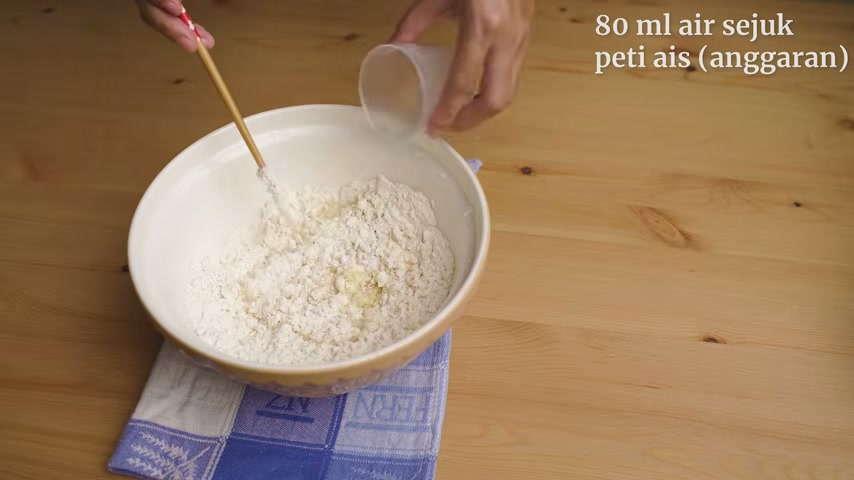
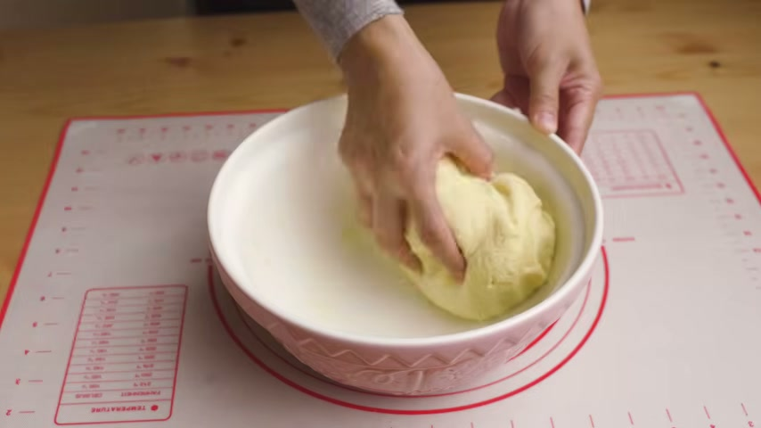
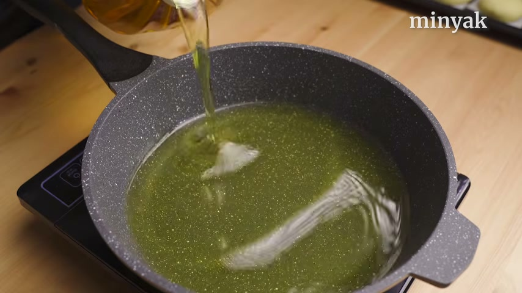
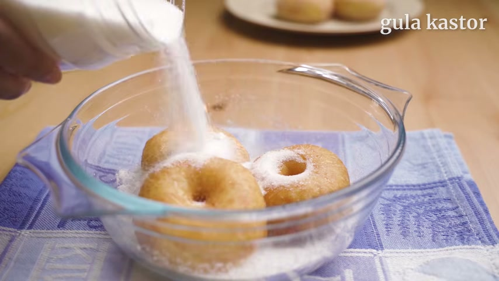


---

# Kuih Bakar Pandan

Sumber: https://www.youtube.com/watch?v=9-_aVLT3jDQ
Pembuat: Che Nom
Tarikh disimpan: 2026-10-07
Jenis: Resipi
Bahasa audio: Bahasa Melayu (ms)

## Bahan

1. Tepung gandum — 2 cawan / 250 g.
2. Gula putih — 1 cawan / 200 g.
3. Garam — ½ sudu kecil.
4. Santan — 2¼ cawan / 563 ml. **[SEMAK]** Deskripsi membetulkan ukuran ml dalam video; gunakan ukuran deskripsi ini.
5. Jus pandan — 1 cawan / 250 ml.
6. Telur — 3 biji; saiz A disebut dalam audio **[SEMAK]**.
7. Marjerin — 2 sudu besar.
8. Pewarna hijau — sedikit.
9. Bijan — secukupnya untuk taburan.

### Bahan tambahan untuk penyediaan

10. Daun pandan — 5–6 helai **[SEMAK]** (kuantiti daripada audio sahaja), untuk menghasilkan jus pandan di atas.
11. Air — sedikit untuk mengisar pandan; sukatan tepat **[TIDAK DINYATAKAN]**. Sedikit air juga boleh digunakan untuk mencairkan santan kotak; sukatan tepat **[TIDAK DINYATAKAN]**.
12. Minyak atau marjerin tambahan — sedikit untuk acuan/loyang; sukatan tepat **[TIDAK DINYATAKAN]**.

## Langkah

Langkah bersumberkan transkrip audio automatik. Suhu, tempoh dan ukuran peralatan yang hanya disebut dalam audio ditandakan **[SEMAK]**.

1. Gunting kasar daun pandan. Masukkan ke dalam pengisar bersama sedikit air dan kisar hingga halus serta menghasilkan jus hijau pekat. Tapis dan tekan dengan sudu untuk mengeluarkan jus. Sukat 1 cawan / 250 ml jus pandan.
2. Panaskan ketuhar pada 170°C **[SEMAK]**, menggunakan api atas dan bawah.
3. Masukkan tepung gandum, gula putih, garam, santan, jus pandan, telur, marjerin dan sedikit pewarna hijau ke dalam pengisar. Jika menggunakan santan kotak, sumber menyebut ia boleh dicairkan dengan sedikit air; nisbah **[TIDAK DINYATAKAN]**. Marjerin tidak perlu dicairkan dahulu.
4. Kisar semua bahan sehingga halus dan sebati. Tapis ke dalam bekas supaya adunan licin dan tidak berketul.
5. Untuk acuan kemboja: masukkan sedikit minyak dan panaskan acuan di atas dapur. Apabila acuan serta minyak panas, taburkan sedikit bijan, kemudian tuang adunan sehingga hampir penuh. Taburkan lagi bijan di permukaan. Sumber turut menyebut acuan boleh dipanaskan dalam ketuhar.
6. Sebagai pilihan, gunakan loyang bulat 8 inci **[SEMAK]**. Gris dengan sedikit marjerin atau minyak. Tidak perlu memanaskan loyang untuk kaedah ini; tuang terus adunan dan taburkan bijan di permukaan.
7. Bakar selama lebih kurang 40–45 minit **[SEMAK]**, atau sehingga permukaan bertukar perang. Pada 10 minit terakhir **[SEMAK]**, naikkan suhu kepada 190°C **[SEMAK]** untuk menggelapkan permukaan.
8. Cucuk dengan lidi. Jika lidi keluar bersih tanpa adunan melekat, kuih sudah masak.
9. Keluarkan dan biarkan sejuk sepenuhnya sebelum dipotong. Hidangkan bersama teh atau kopi jika mahu.

## Petua

- Gunakan cawan penyukat standard untuk membakar, bukan cawan kopi.
- Gula putih biasa boleh digunakan; tidak perlu gula kastor.
- Garam membantu menyerlahkan rasa lemak kuih.
- Memanaskan acuan bersama minyak membantu menghasilkan kerak yang rangup.
- Ciri kuih yang diterangkan sumber ialah bahagian dalam yang lembut, kerak atas perang berkaramel dan aroma pandan serta bijan.

## Catatan sumber dan semakan

- Senarai bahan utama diambil daripada deskripsi; bahagian Bahasa Inggeris menyenaraikan bahan yang sama dan telah disatukan dalam Bahasa Malaysia tanpa pendua.
- Deskripsi menyatakan pembetulan santan: 2¼ cawan / 563 ml; abaikan ukuran ml dalam video **[SEMAK]**.
- Tiada sari kata tersedia. Transkrip audio Bahasa Melayu digunakan; liputan dilaporkan hingga 294 saat daripada video/audio 296 saat, maka penghujung sekitar 2 saat tidak diliputi.
- Kuantiti daun pandan, saiz telur, saiz loyang, suhu dan tempoh pembakaran berasal daripada audio automatik dan perlu disemak **[SEMAK]**.
- Sukatan tepat air, minyak/marjerin tambahan serta nisbah pencairan santan kotak **[TIDAK DINYATAKAN]**.
- Untuk kegunaan peribadi sahaja.

## Gambar

Gambar ditangkap mengikut selang masa video, bukan dipilih mengikut kandungan. Nombor bingkai ialah penanda peratus kedudukan video, bukan masa dalam saat.

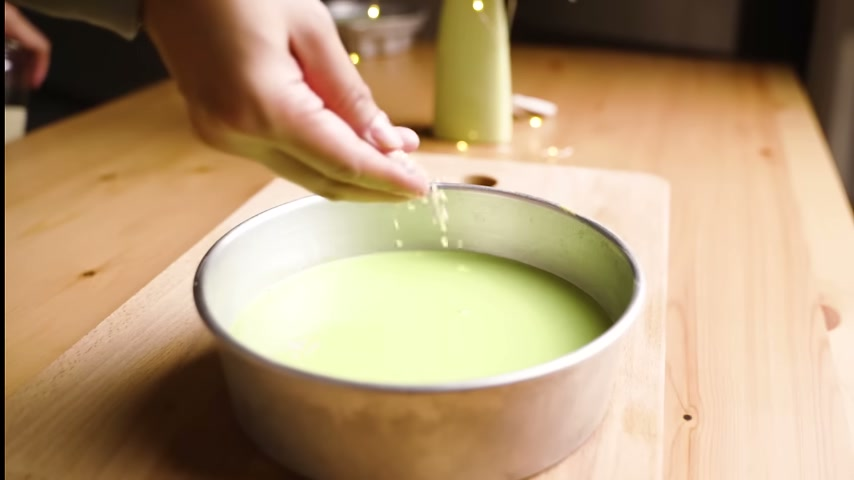

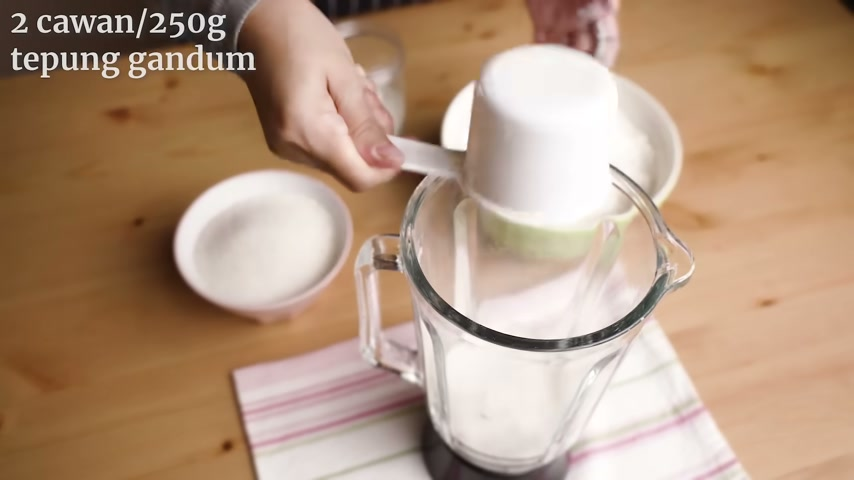

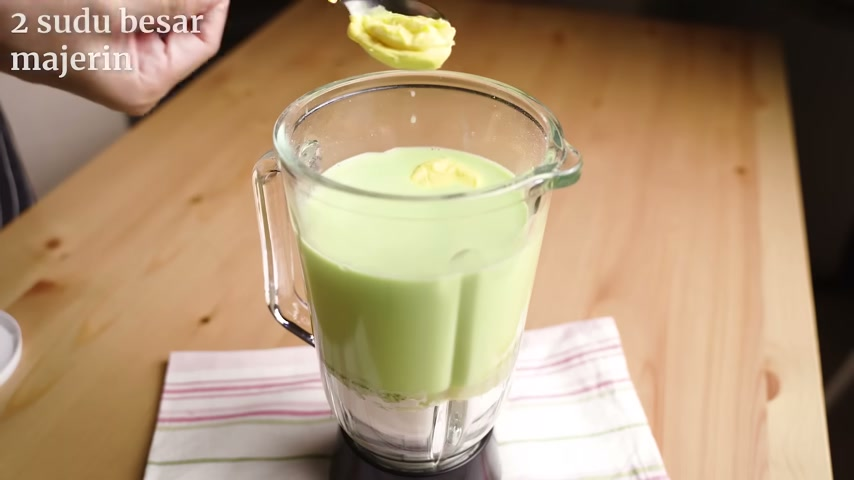

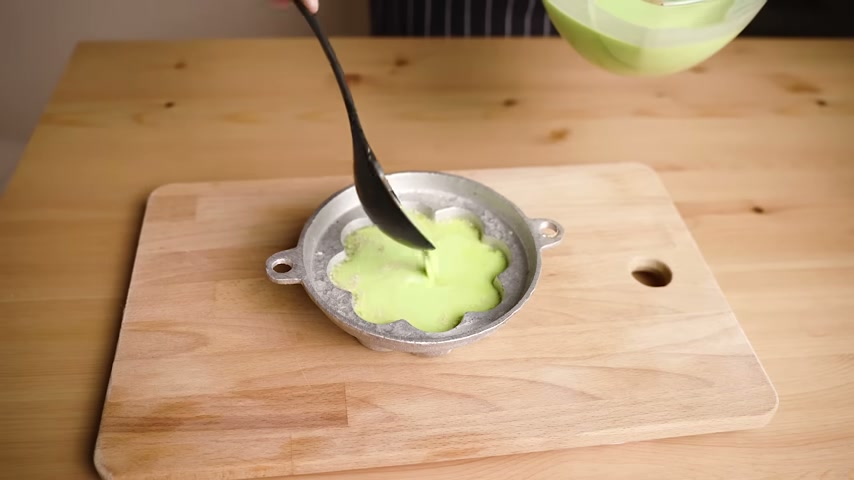

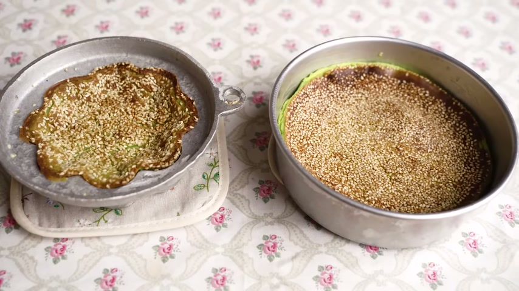


---

# Kuih Lopes Guna Rice Cooker dan Tanpa Kukus

Sumber: https://www.youtube.com/watch?v=sksaJJD45NE
Pembuat: Che Nom
Tarikh disimpan: 2026-10-07
Jenis: Resipi
Bahasa audio: Bahasa Melayu (ms)

## Bahan

### Jus pandan
- 5–6 helai daun pandan.
- 1 cawan air.

### Lopes
- 2 cawan beras pulut; pembuat menyebut menggunakan pulut susu dalam audio [SEMAK].
- 1 1/2 cawan santan cair (pilihan menurut audio).
- Jus pandan daripada bahan di atas.
- Air secukupnya sehingga paras sedikit melebihi satu ruas jari.
- 1/2 sudu kecil pewarna hijau (pilihan menurut audio).

### Air gula
- 1–2 cawan air.
- 1 ketul gula Melaka.
- 2 sudu besar gula perang Thai (pilihan).
- 1 sudu besar gula putih.
- 1–2 helai daun pandan.

### Kelapa parut
- 1/2 biji kelapa parut.
- Garam secukup rasa.
- Daun pandan: kapsyen Bahasa Inggeris menyatakan 1 helai; kapsyen Bahasa Melayu tidak menyatakan kuantiti.

### Untuk acuan
- Sedikit minyak untuk menyapu bekas plastik, disebut dalam audio sahaja [SEMAK]; sukatan tepat [TIDAK DINYATAKAN].

## Langkah

1. Gunting kasar daun pandan untuk jus. Masukkan ke dalam pengisar bersama 1 cawan air dan kisar halus. Tapis untuk mendapatkan jus pandan; ungkapan menapis dalam transkrip kurang jelas [SEMAK].
2. Basuh beras pulut seperti biasa dan masukkan ke dalam periuk nasi. Masukkan jus pandan dan santan cair. Tambah air sehingga paras sedikit melebihi satu ruas jari. Masukkan pewarna hijau jika mahu, kemudian masak menggunakan periuk nasi. Tempoh memasak [TIDAK DINYATAKAN].
3. Sementara pulut dimasak, masukkan air, gula Melaka, gula perang Thai dan gula putih untuk membuat air gula. Carik dan simpulkan daun pandan, kemudian masukkan. Masak sehingga semua gula larut dan air gula sedikit pekat.
4. Pembuat menyebut menambah sedikit lagi gula perang Thai untuk warna lebih gelap [SEMAK]; kuantiti tambahan [TIDAK DINYATAKAN]. Jika tiada gula perang Thai, gunakan gula Melaka dan gula putih sahaja.
5. Tapis air gula untuk membuang hampas kasar, kemudian sejukkan.
6. Kukus kelapa parut bersama sedikit hirisan daun pandan supaya wangi. Tempoh mengukus [TIDAK DINYATAKAN]. Keluarkan dan gaulkan dengan garam secukup rasa supaya rasa lemak kelapa lebih menyerlah.
7. Apabila pulut masak, bentuk menggunakan salah satu cara berikut: sudukan pulut ke dalam acuan bulat berbentuk gelang (ring), kemudian tekan padat; atau sapu sedikit minyak pada bekas plastik, sudukan pulut ke dalamnya dan gunakan sebuah lagi bekas untuk menekan pulut sehingga padat.
8. Gaulkan pulut yang telah dibentuk dengan kelapa parut dan hidangkan bersama air gula.

## Petua

- Pulut dimasak menggunakan periuk nasi, tanpa dikukus; kelapa parut masih dikukus.
- Santan cair dan pewarna hijau ialah pilihan menurut audio.
- Gula perang Thai ialah pilihan; pembuat menggunakannya untuk mendapatkan warna air gula yang lebih gelap.
- Pembuat menyatakan keluarganya suka menyejukkan kuih di dalam peti sejuk sebelum dihidangkan sebagai pencuci mulut.
- Idea menggunakan dua bekas plastik untuk membentuk pulut dikreditkan kepada Kak Lina dari Pulau Pinang dalam deskripsi dan audio.

## Catatan sumber

Bahan dan kuantiti diambil daripada deskripsi. Langkah dan petua diambil daripada transkrip audio Bahasa Melayu yang dijana secara automatik dan mungkin tersalah dengar. Transkrip mencapai kira-kira 281 saat daripada video 283 saat. Sari kata automatik berlabel Perancis (fr-orig) mengandungi ayat yang tidak sepadan dengan resipi; sari kata itu tidak digunakan sebagai panduan memasak. Perkataan atau maklumat yang meragukan ditandakan [SEMAK]. Bilangan hidangan [TIDAK DINYATAKAN].

## Gambar

Gambar ditangkap mengikut selang masa video, bukan dipilih mengikut kandungan. Nama fail bingkai dikekalkan daripada skrip sumber.

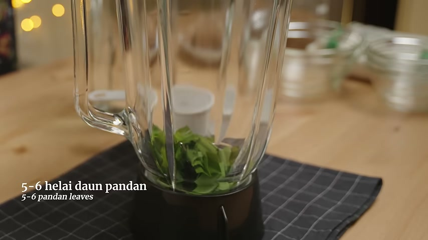
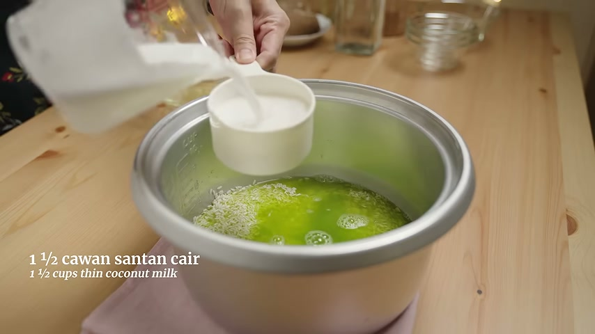
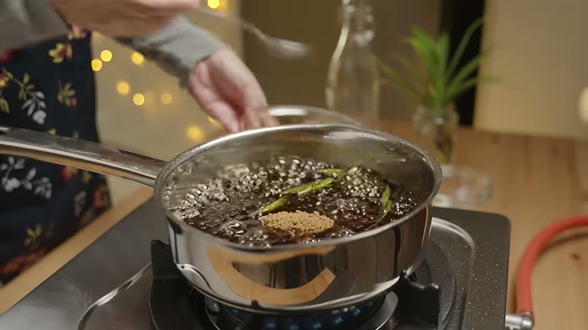
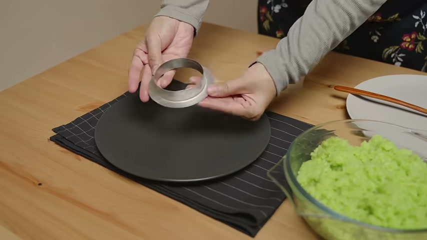
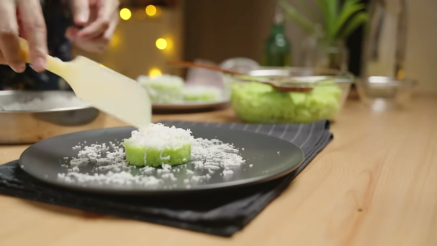


---

# Karipap Rangup Inti Keledek

Sumber: https://www.youtube.com/watch?v=rqCVdf-NC88
Pembuat: Che Nom
Tarikh disimpan: 2026-10-07
Jenis: Resipi
Bahasa audio: Bahasa Melayu berdasarkan deskripsi dan sari kata; bahasa tidak dikenal pasti oleh transkripsi audio.
Anggaran hasil: 35–40 biji.

## Bahan

### Kulit karipap
- Tepung gandum — 500 g / 4 cawan.
- Tepung beras — 2 sudu besar.
- Minyak masak — 125 ml / ½ cawan.
- Marjerin — 28 g / 2 sudu besar.
- Air — 250 ml / 1 cawan. Deskripsi membetulkan sukatan 125 ml yang dipaparkan dalam video; gunakan 250 ml. [SEMAK] Percanggahan sukatan dalam video telah dibetulkan oleh pembuat dalam deskripsi.
- Garam — 1 sudu kecil.

### Inti keledek
- Keledek oren — 1 kg.
- Bawang merah besar — 2 biji.
- Bawang putih — 4 ulas.
- Cili kering — 6–7 tangkai.
- Ikan bilis — 45 g / ½ mangkuk; ATAU udang kering — 3 sudu besar.
- Minyak masak — ½ cawan.
- Kayu manis — 1 batang.
- Cengkih — 3 kuntum.
- Bunga lawang — 2 kuntum. Nama disahkan melalui deskripsi bahasa Inggeris (“star anise”); deskripsi Melayu tersalah eja.
- Daun kari — 2 tangkai.
- Garam — secukup rasa.
- Serbuk perasa — jika suka; kuantiti [TIDAK DINYATAKAN].
- Gula — anggaran 2 sudu besar.
- Air — secukupnya.
- Rempah kari ayam atau daging — 2 sudu besar.
- Daun sup — kuantiti [TIDAK DINYATAKAN].

## Langkah

Langkah di bawah disusun daripada sari kata automatik yang banyak tersalah dengar. Kuantiti bahan diambil daripada deskripsi; butiran masa, berat doh dan arahan yang kurang jelas ditandakan [SEMAK]. Transkrip audio berasingan tidak tersedia kerana audio 722 saat melebihi had 600 saat.

1. Gaulkan tepung gandum, tepung beras dan garam.
2. Panaskan minyak masak bersama marjerin, kemudian tuangkan perlahan-lahan ke dalam campuran tepung. Gaul menggunakan garpu dahulu kerana minyak panas; apabila agak sejuk, sambung gaul menggunakan tangan hingga berderai.
3. Masukkan air sejuk dari peti sejuk sedikit demi sedikit sehingga doh boleh dibentuk. Gunakan sukatan air 250 ml dalam deskripsi, bukan 125 ml dalam paparan video. Doh tidak perlu diuli sehingga licin seperti doh roti.
4. Tutup doh atau masukkan ke dalam plastik dan rehatkan sekurang-kurangnya 1 jam [SEMAK: masa daripada sari kata automatik sahaja]. Sari kata turut menyebut rehat 3–4 jam [SEMAK].
5. Untuk inti, kupas keledek dan potong dadu kecil. Potong kasar bawang untuk dikisar; hiris daun sup.
6. Bancuh rempah kari dengan air; jumlah air bancuhan [TIDAK DINYATAKAN]. Kisar bawang merah, bawang putih, cili kering dan ikan bilis atau udang kering dengan sedikit air. Sari kata menyebut cili kering telah direbus [SEMAK].
7. Panaskan minyak. Tumis kayu manis, cengkih, bunga lawang dan daun kari sehingga naik bau. Masukkan bahan kisar dan bancuhan rempah kari, kemudian masak hingga pecah minyak.
8. Masukkan garam, gula dan serbuk perasa jika digunakan. Masukkan keledek dan gaul. Tuangkan air sehingga keledek agak tenggelam [SEMAK: paras air berdasarkan sari kata automatik].
9. Tutup dan masak dengan api perlahan sehingga keledek lembut dan inti kering. Sari kata menyebut lebih kurang setengah jam atau lebih [SEMAK]. Tutup api, masukkan hirisan daun sup dan sejukkan inti.
10. Bahagikan doh kepada bebola sekitar 25–27 g setiap satu [SEMAK: berat daripada sari kata automatik sahaja], kemudian canai nipis.
11. Letakkan inti dan lipat doh. Tekan bahagian tengah dahulu, rapatkan tepi dan kelim sehingga tertutup. Isi secukupnya tanpa menyukarkan doh dilipat.
12. Panaskan minyak untuk menggoreng; kuantiti minyak [TIDAK DINYATAKAN]. Jangan tunggu minyak terlalu panas. Goreng dengan api sederhana perlahan dan balikkan kerap sehingga perang sekata.
13. Angkat dan toskan minyak apabila karipap sudah masak dan rangup.

## Petua

- Tepung beras ditambah untuk membantu kulit kekal rangup walaupun sejuk, menurut pembuat.
- Gunakan deskripsi sebagai rujukan sukatan air kulit: 250 ml / 1 cawan. Pembuat secara khusus meminta sukatan 125 ml dalam video diabaikan.
- Kulit nipis, kelim tidak tebal dan inti yang penuh ialah ciri karipap yang disukai pembuat.
- Jangan gaul minyak panas terus dengan tangan; gunakan garpu dahulu.
- Sejukkan inti sebelum mengisi karipap.
- Sari kata menyebut minyak yang terlalu panas boleh menyebabkan kulit bergelembung [SEMAK].
- Arahan akhir tentang minyak menggoreng kurang jelas; sari kata seolah-olah menyebut supaya minyak tidak terlalu sedikit [SEMAK].
- Sari kata menyebut daun sup mungkin mempercepatkan inti basi [SEMAK: kenyataan pembuat daripada sari kata yang kurang jelas, bukan panduan keselamatan makanan yang disahkan].
- Tiada bahan, kuantiti atau langkah tambahan diandaikan daripada gambar.

## Gambar

Gambar ditangkap mengikut selang masa video dan bukan dipilih mengikut kandungan. Nama bingkai dikekalkan seperti hasil skrip; nombor fail tidak dianggap sebagai cap masa dalam saat. Bingkai terakhir menunjukkan karipap sedang digoreng sehingga keemasan, bukan hidangan yang telah dihidangkan.

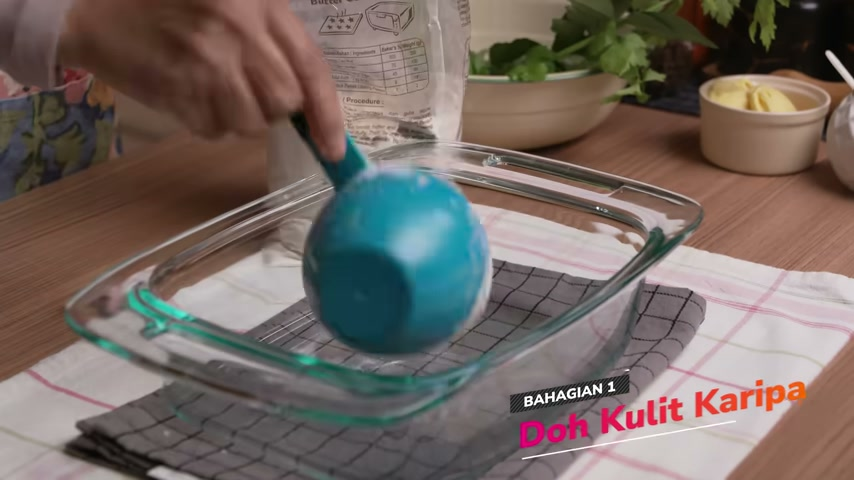
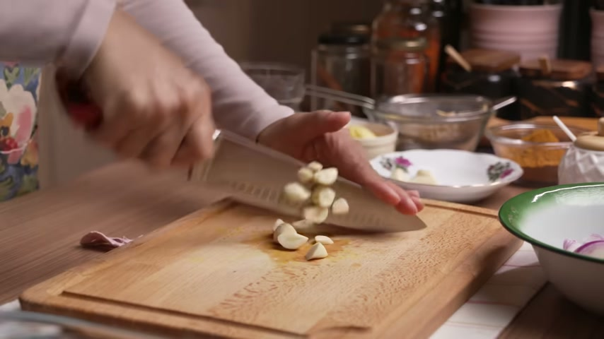
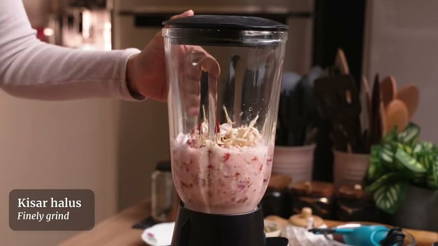
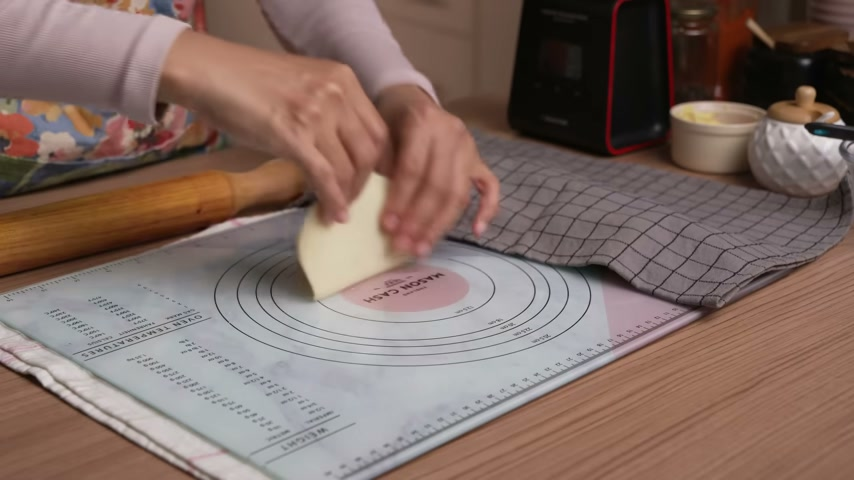
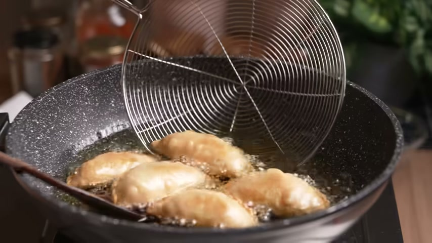


---

# Cucur Kembung Cicah Sambal Sardin

Sumber: https://www.youtube.com/watch?v=yQOZPEjUJhw
Pembuat: Che Nom
Tarikh disimpan: 7 Oktober 2026
Jenis: Resipi
Bahasa audio: Bahasa Melayu (ms)

## Bahan

### Cucur kembung
- Tepung gandum: 2 cawan / 250 g.
- Air suam: 3/4 cawan.
- Yis kering: 1 1/2 sudu kecil.
- Gula: 2 sudu besar.
- Garam: 1/2 sudu kecil.
- Air tambahan: 1/2 cawan; masukkan sedikit demi sedikit mengikut keadaan doh.
- Marjerin: 1 sudu besar.
- Tepung tambahan untuk doh yang melekat dan ketika memotong: [TIDAK DINYATAKAN].
- Minyak untuk menggoreng: [TIDAK DINYATAKAN]; audio menyebut gunakan minyak yang agak banyak.

### Sambal sardin
- Sardin: 1 tin besar.
- Bawang putih: 3 ulas; hiris nipis.
- Bawang merah kecil: 1–2 biji; hiris nipis.
- Cili kisar: 2–3 sudu besar.
- Tomato: 2 biji; belah empat.
- Sos tiram: 1 sudu besar.
- Kentang: 1 biji; potong dadu kecil.
- Bawang besar: 1 biji; potong kasar untuk dimasukkan pada akhir masakan.
- Jus atau air asam jawa: 1–2 sudu besar.
- Garam: secukup rasa.
- Cili merah dan cili padi: [TIDAK DINYATAKAN]; pilihan mengikut selera.
- Minyak untuk menumis: [TIDAK DINYATAKAN].
- Air untuk membancuh asam jawa atau menambah kuah: [TIDAK DINYATAKAN].

## Langkah

### Cucur kembung
1. Campurkan air suam, yis kering dan gula dalam bekas. Kacau hingga sekata dan ketepikan beberapa minit sehingga yis mengembang. Tempoh tepat: [TIDAK DINYATAKAN].
2. Campurkan tepung gandum dengan garam. Tuangkan campuran yis yang sudah mengembang dan gaul hingga sebati. Boleh menggunakan pengikis plastik sebelum menguli dengan tangan.
3. Uli doh. Jika terlalu keras, tambah air sedikit demi sedikit; tidak semestinya perlu menggunakan semua air tambahan. Jika doh terlalu lembik dan melekat, tabur sedikit tepung secara beransur-ansur.
4. Masukkan marjerin dan uli sehingga doh agak elastik, licin dan kurang melekat pada tangan.
5. Bulatkan doh dan rehatkan sehingga mengembang, kira-kira 40 minit hingga 1 jam [SEMAK — tempoh daripada audio/sari kata, bukan kapsyen]. Tempohnya boleh lebih lama mengikut cuaca dan suhu tempat perapan.
6. Selepas doh mengembang, tumbuk perlahan untuk mengeluarkan angin, kemudian tekan atau uli sedikit.
7. Ratakan menggunakan tangan atau penggelek hingga ketebalan kira-kira 1.5 cm [SEMAK — ukuran daripada audio/sari kata, bukan kapsyen]. Tabur sedikit tepung supaya tidak melekat ketika dipotong.
8. Potong mengikut bentuk yang disukai; saiz tidak perlu sama. Audio menyebut doh dipotong menjadi 18 bahagian [SEMAK — bilangan daripada audio sahaja; bukan hasil wajib].
9. Biarkan doh yang sudah dipotong kira-kira 5 minit [SEMAK — tempoh daripada audio/sari kata, bukan kapsyen].
10. Goreng dalam minyak panas yang agak banyak menggunakan api sederhana sehingga masak sekata. Tempoh menggoreng: [TIDAK DINYATAKAN]. Api terlalu kuat boleh menyebabkan luar cepat perang tetapi bahagian dalam belum masak.
11. Angkat, toskan minyak dan hidangkan panas bersama sambal sardin.

### Sambal sardin
1. Sediakan bawang putih dan bawang merah yang dihiris nipis, tomato yang dibelah empat, kentang yang dipotong dadu kecil serta bawang besar yang dipotong kasar. Jika menggunakan pes asam jawa berbiji, bancuh dengan sedikit air.
2. Panaskan minyak dan tumis bawang putih serta bawang merah yang dihiris.
3. Masukkan cili kisar. Masak sehingga cili kering dan pecah minyak.
4. Masukkan tomato dan masak sehingga lembut serta hancur dalam sambal untuk memekatkan kuah.
5. Tuangkan kuah sardin dahulu; simpan isi ikan untuk dimasukkan kemudian.
6. Masukkan kentang dan air asam jawa. Teruskan memasak sehingga kentang lembut.
7. Masukkan sos tiram dan isi ikan sardin. Apabila mendidih, rasa dan tambah garam jika perlu.
8. Masukkan bawang besar. Jika mahu lebih berkuah, tambah air mengikut selera. Masukkan cili merah dan cili padi jika suka.
9. Hidangkan sebagai pencicah cucur kembung.

## Petua

- Yis yang mengembang selepas dicampur air suam dan gula menunjukkan yis masih aktif. Menurut audio, pemeriksaan awal ini boleh dilangkau jika yakin yis masih baik.
- Tepung roti boleh digunakan sebagai pilihan menurut audio; kuantiti penggantian khusus: [TIDAK DINYATAKAN]. Senarai bahan kapsyen menggunakan tepung gandum.
- Tambah air dan tepung sedikit demi sedikit supaya doh tidak terlebih lembik atau terlalu keras.
- Jika doh berlekuk akibat dipegang, goreng dengan bahagian berlekuk menghadap ke atas supaya mengembang dan menjadi lebih licin.
- Cucur lebih rangup di luar apabila dimakan panas, manakala bahagian dalamnya gebu.
- Cili merah dan cili padi ialah pilihan untuk menambah rasa pedas.
- Audio menyebut 2 tin kecil boleh menggantikan 1 tin besar [SEMAK — bilangan daripada audio sahaja]. Jika menggunakan 1 tin kecil, audio menyarankan separuh resipi [SEMAK]. Saiz atau berat tin: [TIDAK DINYATAKAN].

## Catatan sumber dan semakan

- Bahan serta kuantiti utama diambil daripada deskripsi Bahasa Melayu dan disemak dengan senarai Bahasa Inggeris yang sepadan. Langkah dan petua diambil daripada sari kata automatik serta transkrip audio.
- Sari kata dilabel automatik `id-orig`, tetapi pertuturan/transkrip yang dilaporkan adalah Bahasa Melayu. Kedua-duanya mengandungi kesalahan pengecaman; perkataan yang jelas disokong konteks dan kapsyen dinyatakan dalam Bahasa Malaysia.
- Audio bagi pilihan pengganti marjerin tidak jelas; pilihan itu tidak dimasukkan untuk mengelakkan mereka bahan.
- Audio berdurasi 539 saat dan transkrip berakhir pada 532 saat; tempoh video tidak dilaporkan. Kelengkapan pertuturan selepas penghujung transkrip tidak dapat dipastikan.
- Kuantiti dan tempoh yang tidak terdapat dalam kapsyen ditandakan [SEMAK].

## Gambar

[TIDAK DINYATAKAN] — skrip pengumpulan tidak menghasilkan gambar (0 fail), maka tiada gambar dipautkan.

Gambar dalam aliran pengumpulan ini ditangkap mengikut selang masa video, bukan dipilih mengikut kandungan.


---

# Kentang Rangup Bersalut Parmesan dan Roti Bakar Herba

Sumber: https://youtu.be/QRTF3y1ywX4?si=j0d7w5prUU6VITeV
Pembuat: Erstaunliche Rezepte
Tarikh disimpan: 2026-10-08
Jenis: Resipi
Bahasa audio: [TIDAK DINYATAKAN] — tiada pertuturan dikesan. Skrip melabelkan bahasa sebagai `en`, tetapi tiada transkrip untuk mengesahkannya.

## Bahan

### Kentang dan adunan
- Kentang besar — 2 biji (500 gram).
- Air sejuk untuk merebus — [TIDAK DINYATAKAN].
- Garam — 2 cubit.
- Serbuk paprika — 1 sudu teh [SEMAK]. Deskripsi bahasa Jerman menyebut paprika, tetapi sari kata bahasa Albania menyebut lada hitam pada bahagian ini. Deskripsi diutamakan.
- Lada hitam — [TIDAK DINYATAKAN].
- Daun parsli (Petersilie) — 1 ikat, dicincang halus.
- Tepung jagung — 2 sudu besar.

### Salutan dan menggoreng
- Telur — 1 biji.
- Garam — 1 cubit.
- Serbuk roti — [TIDAK DINYATAKAN].
- Keju Parmesan — 1 sudu besar.
- Daun selasih (Basilikum) — [TIDAK DINYATAKAN].
- Minyak sayuran — [TIDAK DINYATAKAN].

### Roti bakar herba
- Roti pilihan — [TIDAK DINYATAKAN].
- Garam — [TIDAK DINYATAKAN].
- Campuran herba Itali — [TIDAK DINYATAKAN].
- Serbuk lada berasap (geräucherter Pfeffer) — [TIDAK DINYATAKAN] [SEMAK: jenis lada tidak diperincikan oleh sumber].
- Serbuk bawang putih — [TIDAK DINYATAKAN].
- Minyak zaitun — [TIDAK DINYATAKAN].
- Keju Parmesan — [TIDAK DINYATAKAN].

## Langkah

### Kentang rangup
1. Potong 2 biji kentang besar (500 gram). Tuangkan air sejuk ke atas kentang dan rebus sehingga lembut.
2. Sumber seterusnya menyenaraikan 2 cubit garam, 1 sudu teh paprika [SEMAK], lada hitam, 1 ikat parsli yang dicincang halus dan 2 sudu besar tepung jagung sebagai bahan adunan. Cara melumatkan kentang dan mencampurkan bahan menjadi adunan: [TIDAK DINYATAKAN] dalam teks sumber.
3. Bahagikan adunan kepada 5 bahagian. Tekan sedikit dengan garpu. Bentuk tepat: [TIDAK DINYATAKAN].
4. Sediakan 1 biji telur bersama 1 cubit garam untuk salutan. Cara mengadun telur: [TIDAK DINYATAKAN].
5. Sediakan campuran serbuk roti, daun selasih dan 1 sudu besar keju Parmesan.
6. Celupkan kentang ke dalam telur, kemudian salut dengan campuran serbuk roti, selasih dan Parmesan.
7. Masukkan ke dalam minyak sayuran yang panas dan goreng sehingga perang keemasan. Suhu minyak dan tempoh menggoreng: [TIDAK DINYATAKAN].
8. Gunakan tisu dapur untuk menyerap minyak berlebihan.

### Roti bakar herba
1. Sediakan roti pilihan bersama garam, herba Itali, serbuk lada berasap [SEMAK], serbuk bawang putih, minyak zaitun dan Parmesan. Cara memotong roti serta cara menyapu atau mencampurkan bahan: [TIDAK DINYATAKAN] dalam teks sumber.
2. Bakar di dalam ketuhar pada 200°C (400°F, seperti dinyatakan oleh sumber) selama 10 minit.

## Petua

- Pembuat menyarankan penggunaan daun selasih untuk memberi rasa pada salutan kentang.
- Serap minyak berlebihan dengan tisu dapur selepas menggoreng.
- Deskripsi menyifatkan hasil kentang sebagai rangup di luar dan lembut di dalam.
- Resipi ini diterjemahkan daripada deskripsi bahasa Jerman dan sari kata bahasa Albania. Perbezaan terjemahan paprika/lada hitam ditandakan pada bahan; tiada transkrip audio tersedia.
- Jumlah hidangan: [TIDAK DINYATAKAN]. Pembahagian adunan kepada 5 bahagian bukan pengesahan jumlah hidangan.

## Gambar

Gambar ditangkap mengikut selang masa video, bukan dipilih mengikut kandungan. Nombor fail dikekalkan dan tidak dianggap sebagai cap masa dalam saat.

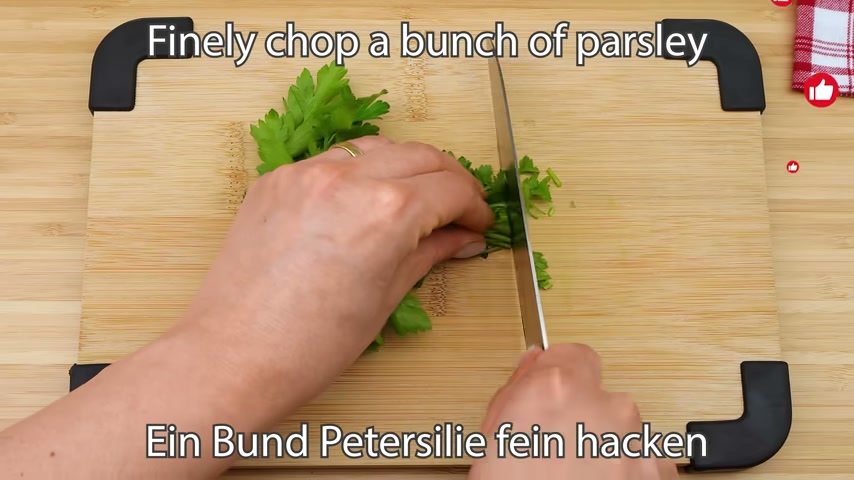


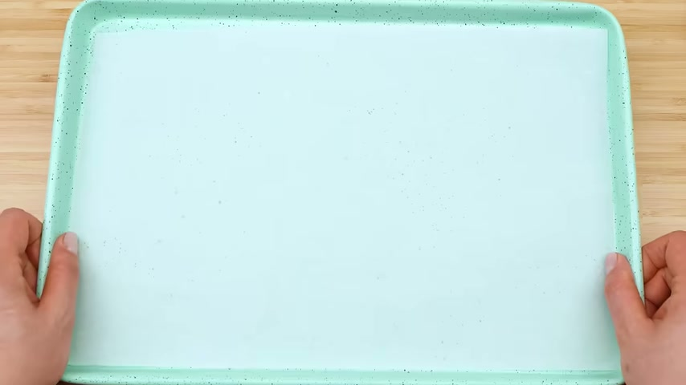


---

# Pho Vietnam

Sumber: https://youtu.be/9Sg21AHuO4A?si=7u2bOTERtsYB0T1E
Pembuat: RecipeTin Eats
Tarikh disimpan: 2026-10-08
Jenis: Resipi
Bahasa audio: [TIDAK DINYATAKAN] — tiada pertuturan dikesan. Label bahasa `en` daripada skrip tidak dapat disahkan kerana tiada transkrip audio.

## Bahan

[TIDAK DINYATAKAN] — deskripsi video tidak menyenaraikan bahan atau kuantiti. Tiada sari kata atau transkrip audio diperoleh.

## Langkah

1. [TIDAK DINYATAKAN] — deskripsi video tidak memberikan langkah penyediaan, dan tiada sari kata atau transkrip audio diperoleh. Langkah tidak diandaikan daripada gambar.

## Petua

- [TIDAK DINYATAKAN] — tiada petua memasak dalam teks sumber yang diperoleh.
- Terjemahan deskripsi: “Tonton cara menyediakan Pho, hidangan paling ikonik Vietnam!”
- Deskripsi memberikan pautan resipi: https://www.recipetineats.com/vietnamese-pho-recipe/
- Kandungan halaman resipi tersebut tidak diambil; catatan ini hanya berdasarkan maklumat yang diperoleh daripada video melalui skrip yang ditetapkan.

## Gambar

Gambar ditangkap mengikut selang masa video, bukan dipilih mengikut kandungan. Nombor fail dikekalkan dan tidak dianggap sebagai cap masa dalam saat.

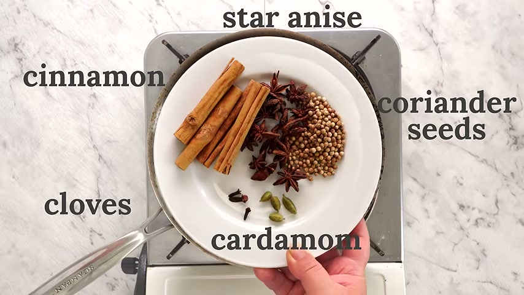

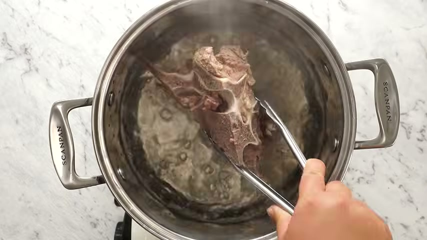

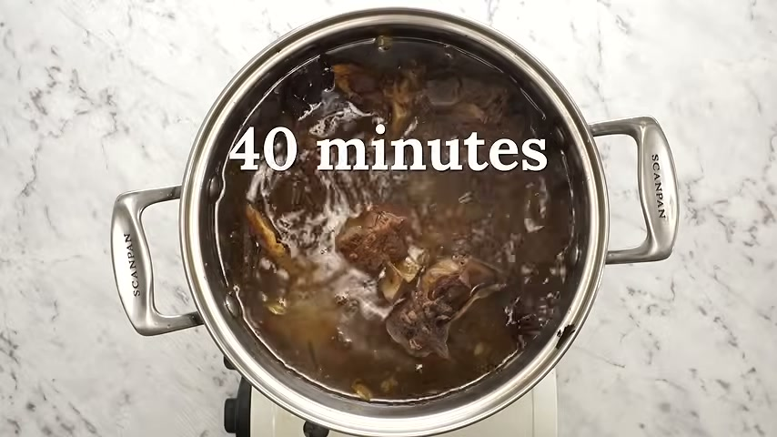

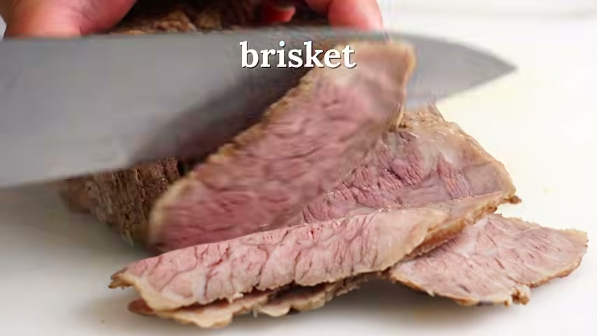

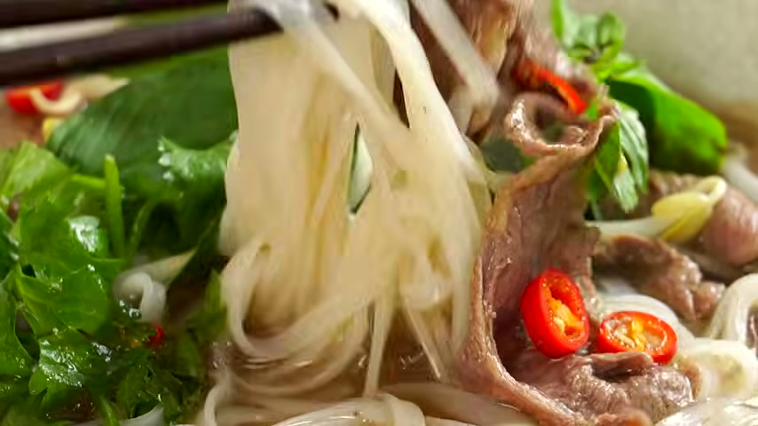


---

# Ayam Halia Thai (Gai Pad King)

Sumber: https://www.youtube.com/watch?v=jh6MRBQa0qs
Pembuat: Satyam's Kitchen
Tarikh disimpan: 2026-10-08
Jenis: Resipi
Bahasa audio: [TIDAK DINYATAKAN] — tiada pertuturan dikesan; label bahasa automatik ialah en tetapi tidak dapat disahkan.

## Pengenalan

Gai Pad King ialah hidangan Thai berasaskan ayam, halia dan cendawan, dengan rasa berperisa, sedikit manis dan sedikit pedas. Menurut deskripsi, halia, bawang putih dan sos tiram memberikan rasa berperisa, sementara gula dan sos ikan menambahkan rasa manis dan masin. Hidangan ini sesuai untuk jamuan keluarga atau dihidangkan bersama nasi. Lazimnya dihidangkan dengan nasi melur kukus (jasmine rice). Deskripsi turut menyebut padanan dengan bir sejuk dan kesesuaiannya dinikmati sepanjang tahun, sama ada ketika cuaca panas atau sejuk.

## Bahan

### Sukatan jelas pada gambar video

- Gula — **1 sudu teh**. Teks pada bingkai 15: “Sugar 1 Tsp”. Ini sukatan sumber, bukan anggaran.

### Bahan dan anggaran visual

- Ayam — dipotong kecil. Berat mentah tidak dapat dianggarkan dengan munasabah daripada gambar ayam yang sedang dimasak. Deskripsi mencadangkan paha ayam tanpa tulang dan kulit.
- Halia segar — dihiris memanjang; **kira-kira 1 genggam kecil [ANGGARAN VISUAL]**, berdasarkan jumlah hirisan yang tersebar dalam kuali pada bingkai 55. Anggaran kasar, bukan sukatan asal pembuat; sebahagian hirisan mungkin terlindung.
- Bawang putih segar.
- Cendawan — kelihatan kepingan gelap pada bingkai 75 dan 92; jenis khusus tidak dapat dipastikan.
- Sos tiram.
- Kicap (soy sauce) — jenis tidak dapat dipastikan.
- Sos ikan.

**Catatan kuantiti:** Sukatan ayam, bawang putih, cendawan, sos tiram, kicap dan sos ikan **[TIDAK DINYATAKAN]** dan tidak dapat dinilai dengan yakin daripada lima bingkai yang tersedia. Sos pada bingkai 35 sudah bercampur, jadi jumlah setiap sos tidak boleh dibezakan. Anggaran halia ialah panduan kasar sahaja, bukan ukuran standard.

### Bahan tambahan yang kelihatan

- Bawang besar, dihiris — kelihatan pada bingkai 75; kuantiti **[TIDAK DINYATAKAN]**.
- Hirisan merah — kelihatan pada bingkai 55, 75 dan 92, tetapi tidak dapat dipastikan sama ada semuanya cili atau lada benggala **[SEMAK]**. Kuantiti tidak dapat dipastikan; jangan menganggapnya bahan pedas tertentu.
- Potongan hijau — kelihatan pada bingkai 92, tetapi identiti dan kuantiti tidak dapat dipastikan **[SEMAK]**.

Cadangan pilihan daripada deskripsi, bukan sukatan asal video:
- Herba segar untuk hiasan.
- Cendawan portobello atau enoki sebagai variasi.
- Lada benggala (bell peppers) atau sayur lain sebagai variasi.
- Nasi melur kukus untuk dihidangkan bersama.

Kuantiti bahan pilihan di atas **[TIDAK DINYATAKAN]**.

## Langkah

1. Potong ayam menjadi ketulan kecil bersaiz sekali suap supaya masak dengan cepat dan sekata.
2. Sediakan campuran sos daripada sos tiram, kicap, gula dan sos ikan. Gula ialah 1 sudu teh mengikut teks bingkai 15; bingkai 35 menunjukkan campuran sos sudah siap. Sukatan sos lain dan urutan mencampurkannya tidak diketahui.
3. Gunakan wok atau kuali besar untuk menggoreng kacau. Deskripsi mencadangkan api besar dan memasak dalam kelompok kecil supaya kuali tidak terlalu penuh. Bingkai 55 menunjukkan ayam, hirisan halia dan hirisan merah di dalam kuali serta teks “Sauce” dengan penanda api besar; gunakan campuran sos untuk memperasakan masakan. Deskripsi turut menyebut bawang putih dan cendawan, tetapi urutan memasukkan setiap bahan tidak dapat dipastikan daripada bingkai terhad.
4. Pada peringkat bingkai 75, bawang besar, hirisan merah dan kepingan cendawan sudah kelihatan di dalam kuali. **Gaul dan masak selama 1 minit dengan api sederhana**, mengikut teks dan penanda api pada bingkai itu. Tempoh ini merujuk peringkat tersebut sahaja, bukan keseluruhan masa memasak ayam.
5. Hidangkan panas sebaik sahaja siap dimasak, sebagai lauk atau hidangan utama bersama nasi. Jika mahu, hiaskan dengan herba segar seperti cadangan deskripsi.

**Catatan langkah:** Minyak atau bahan untuk menumis, masa memasak awal dan urutan lengkap penambahan bahan **[TIDAK DINYATAKAN]** dalam bukti yang tersedia. Bingkai terpilih tidak meliputi setiap peringkat video.

## Petua

1. Gunakan paha ayam tanpa tulang dan kulit: menurut pembuat, bahagian ini lebih berjus dan berperisa berbanding dada ayam serta sesuai untuk goreng kacau.
2. Potong ayam kecil-kecil supaya cepat masak dan sekata.
3. Gunakan halia dan bawang putih segar kerana rasanya lebih kuat berbanding bahan kering.
4. Wok atau kuali besar membolehkan bahan dimasak dengan cepat menggunakan api besar.
5. Masak sedikit demi sedikit supaya kuali tidak terlalu penuh dan bahan masak sekata.
6. Laraskan perasa mengikut selera untuk mengubah rasa masin, manis atau pedas.
7. Hidangkan segera ketika masih panas bersama nasi.
8. Herba segar boleh digunakan untuk menambah rasa dan warna.
9. Cuba cendawan portobello atau enoki untuk tekstur dan rasa yang berbeza.
10. Sayur lain seperti lada benggala boleh digunakan sebagai variasi rasa dan tekstur.

### Catatan sumber

Deskripsi memberikan gambaran umum cara memasak dan petua tanpa sukatan. Semakan kelima-lima gambar menambah sukatan gula 1 sudu teh, arahan memasak 1 minit dengan api sederhana serta bahan yang kelihatan. Teks yang jelas pada gambar dianggap maklumat sumber; anggaran halia dilabel [ANGGARAN VISUAL] dan bukan sukatan asal pembuat. Gambar selang masa tidak meliputi keseluruhan proses, jadi bahan atau sukatan yang terlindung tidak dilengkapkan secara rekaan. Transkrip audio tidak tersedia kerana tiada pertuturan dikesan. Sari kata automatik hanya mengandungi penanda muzik dan perkataan umum yang tidak menerangkan masakan; ia tidak digunakan untuk menambah bahan atau langkah. Pautan resipi bertulis dalam deskripsi tidak diambil sebagai sumber tambahan.

## Gambar

Gambar ditangkap mengikut selang masa video, bukan dipilih mengikut kandungan. Nombor pada nama bingkai bukan masa dalam saat yang disahkan.


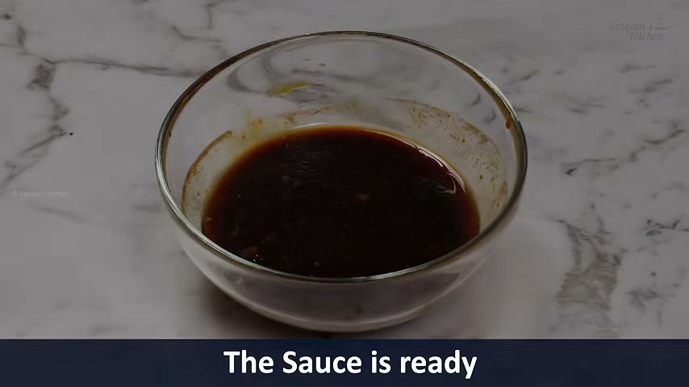

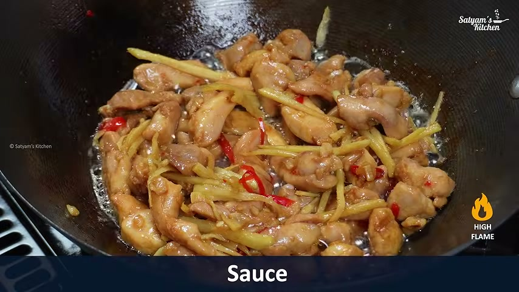

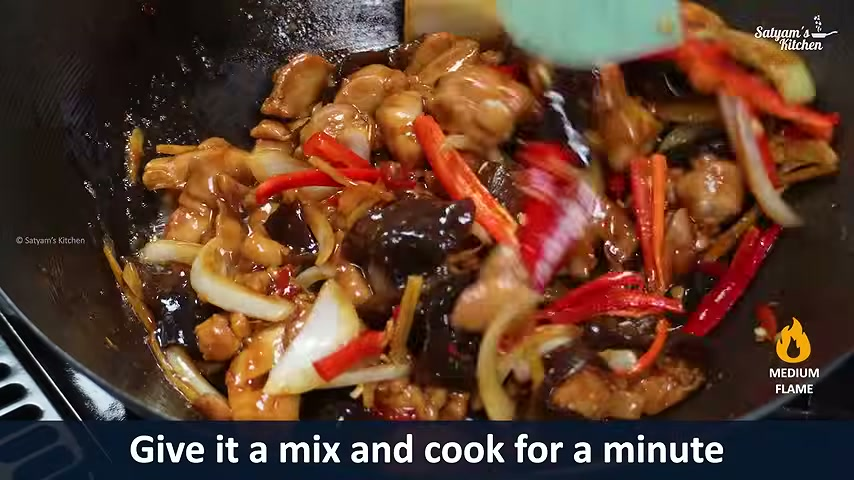

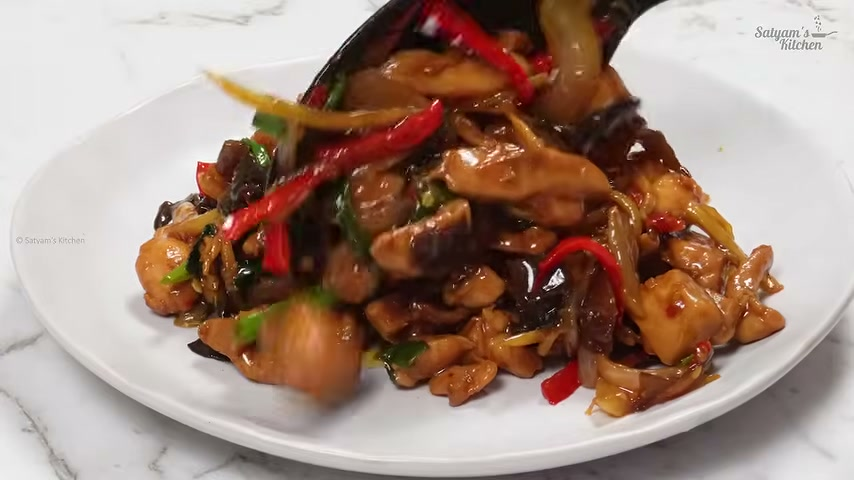


---

# Sambal Belimbing Buluh

Sumber: https://www.facebook.com/share/r/1DdBm8cuwu/
Pautan video dikenal pasti: https://m.facebook.com/watch/?v=1626060032519961&_rdr
Pembuat: Jacob Jacksonl
Tarikh disimpan: 2026-10-09
Jenis: Resipi
Bahasa audio: [SEMAK] — pengesan automatik melabel bahasa Melayu (ms), tetapi transkrip banyak perkataan tidak jelas dan tidak dapat digunakan sebagai terjemahan pertuturan yang boleh dipercayai. Teks pada gambar dalam Bahasa Malaysia dapat dibaca.

## Bahan

Sukatan berikut diambil daripada kapsyen pembuat, bukan anggaran:

- Belimbing buluh — 20 biji.
- Minyak masak — lebihkan sedikit, seperti arahan pembuat; sukatan dalam sudu atau mililiter tidak dinyatakan.
- Ikan bilis kopek — 2 genggam. Sukatan ini turut jelas pada bingkai 55.
- Cili besar — 10 biji. Jika mahu pedas, campurkan cili padi; kuantiti cili padi tidak dinyatakan.
- Bawang merah — 8 biji.
- Gula apong — 1 sudu besar.
- Garam — 3/4 sudu besar.
- Perasa — 1/2 sudu besar; jenis atau jenama tidak dinyatakan.

**Catatan sukatan:** Sukatan minyak dan cili padi tambahan **[TIDAK DINYATAKAN]** secara angka. Bingkai 55 menunjukkan minyak bertakung di dasar kuali, tetapi isipadunya tidak boleh dianggarkan dengan yakin tanpa ukuran kuali. Sukatan bahan lain sudah tersedia dalam kapsyen, jadi tidak memerlukan [ANGGARAN VISUAL].

## Langkah

1. Cuci belimbing buluh hingga bersih. Bingkai 35 menunjukkan buah dimasukkan ke dalam bekas pengisar dengan teks “Cuci bagi bersih”. Cara memotong, tahap kisaran dan sama ada buah ditapis selepas dikisar **[SEMAK]**: tidak dapat disahkan daripada gambar yang tersedia, dan transkrip tidak cukup jelas.
2. Tumis dahulu 2 genggam ikan bilis kopek dalam minyak masak. Arahan dan sukatan ini jelas pada bingkai 55.
3. Gabungkan ikan bilis dengan belimbing buluh, cili besar dan bawang merah untuk membentuk sambal. Cara menyediakan cili dan bawang serta urutan tepat memasukkan bahan **[TIDAK DINYATAKAN]** dalam bukti yang boleh dipercayai. Bingkai 75 menunjukkan bahan sudah bercampur dan sedang digaul.
4. Masukkan gula apong, garam dan perasa mengikut sukatan kapsyen. Masa tepat menambah setiap perasa tidak dapat dipastikan daripada bingkai yang tersedia; jangan anggap semuanya dimasukkan serentak.
5. Masak menggunakan api perlahan selama 30–60 minit sambil sentiasa menggaul, seperti arahan kapsyen. Pada bingkai 92, pembuat menyatakan “Sampai juga 30 minit saya masak”; sambal kelihatan berwarna lebih gelap. Ini menunjukkan contoh dalam video dimasak sekitar 30 minit, dalam julat masa yang diberikan pada kapsyen.
6. Hidangkan bersama nasi jika mahu; bingkai 15 menunjukkan sambal yang telah siap dimakan bersama nasi.

## Petua

- Sentiasa gaul sambal semasa memasak.
- Gunakan api perlahan. Pembuat mencadangkan tempoh 30–60 minit dengan tujuan sambal lebih tahan apabila disimpan dalam bekas.
- Tambahkan cili padi jika mahukan sambal lebih pedas.

### Catatan sumber dan semakan

Kapsyen memberikan semua sukatan utama. Kelima-lima gambar telah diperiksa dan digunakan untuk mengesahkan arahan mencuci buah, menumis ikan bilis dahulu, menggaul sambal serta tempoh 30 minit pada contoh video. Gambar tidak merakam setiap peringkat; proses kisaran, penapisan dan urutan penuh penambahan bahan masih belum dapat disahkan. Transkrip automatik meliputi tempoh video tetapi banyak perkataan tersalah dengar, maka ia tidak digunakan untuk mereka langkah atau bahan tambahan. Dakwaan ketahanan sambal di atas ialah petua pembuat; tempoh simpanan dan kaedah penyimpanan terperinci **[TIDAK DINYATAKAN]**.

## Gambar

Gambar ditangkap mengikut selang masa video, bukan dipilih mengikut kandungan. Nombor nama bingkai bukan masa dalam saat yang disahkan.

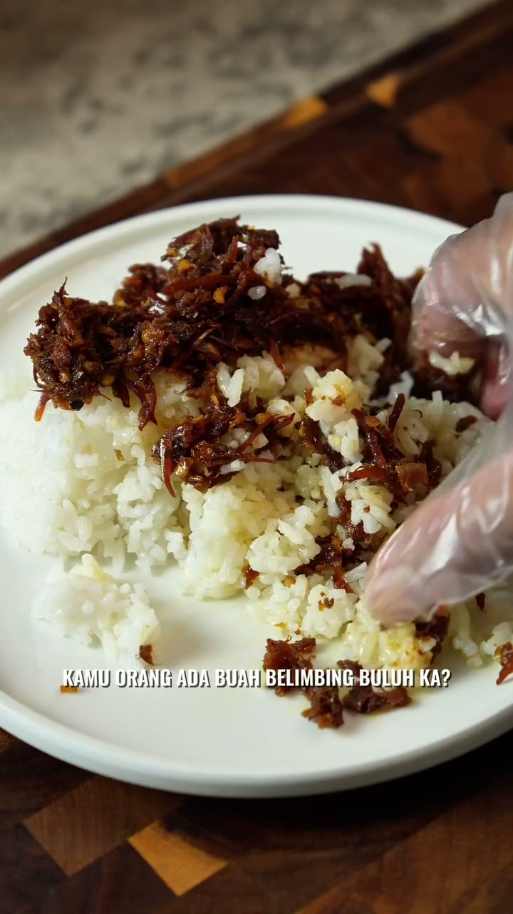


---

# Mee Celup Thai versi Akak Founder

Sumber: https://www.facebook.com/share/v/19fiHrJYX4/
Pautan video asal: https://m.facebook.com/watch/?v=2055247098381036&_rdr
Pembuat: Yuwadee Akak Founder
Tarikh disimpan: 2026-10-10
Jenis: Resipi
Bahasa audio: Bahasa Malaysia

## Bahan

### Kuah sup
- Air — 2 liter [SEMAK: sukatan daripada transkrip audio sahaja].
- Herba untuk sup — jenis dan kuantiti [TIDAK DINYATAKAN]; dibungkus dalam kain putih.
- Daun pandan — kuantiti [TIDAK DINYATAKAN]; kelihatan di dalam periuk pada bingkai 35.
- Bawang jeruk — [SEMAK: disebut dalam transkrip audio; jenis dan kuantiti tidak dapat dipastikan].
- Gula batu — kuantiti [SEMAK]; transkrip menyebut anggaran gram tetapi bilangannya tidak jelas. Gula batu kelihatan pada bingkai 15.
- Garam — separuh sudu [SEMAK: daripada audio sahaja; jenis sudu tidak dinyatakan].
- Bahan yang ditranskripsikan sebagai “cepcai” — 2 sudu [SEMAK: nama bahan dan sukatan audio perlu disahkan].
- Sos tiram — 4 sudu [SEMAK: daripada audio sahaja; jenis sudu tidak dinyatakan].
- Kicap pekat — 2 sudu [SEMAK: daripada audio sahaja; jenis sudu tidak dinyatakan].
- Bahan yang ditranskripsikan sebagai “tem tip” — 1 sudu [SEMAK: nama bahan dan sukatan audio perlu disahkan; jangan dianggap sebagai bahan tertentu tanpa pengesahan].
- Kicap cair — teks pada bingkai 35 menyebut “KICAP CAIR 2”; unit tidak tertera. Transkrip bahagian ini tidak jelas [SEMAK unit/sukatan penuh].
- Ayam — kuantiti [TIDAK DINYATAKAN]; ketulan ayam mentah kelihatan pada bingkai 15.
- Lobak putih — pilihan; kuantiti [TIDAK DINYATAKAN]. Nama ini berdasarkan transkrip audio dan perlu [SEMAK].

### Mi dan pelengkap
- Mi — jenis dan kuantiti [TIDAK DINYATAKAN]; nama hidangan disahkan dalam kapsyen.
- Taugeh dan sayur berdaun hijau — kelihatan dalam mangkuk pada bingkai 55; jenis sayur hijau [SEMAK].
- Bebola — kelihatan dalam mangkuk pada bingkai 55; jenis [TIDAK DINYATAKAN].
- Bahan taburan berketul kecil, menyerupai kacang cincang — [SEMAK identiti], kelihatan pada bingkai 55.
- Daun hiasan, menyerupai daun ketumbar — [SEMAK identiti], kelihatan pada bingkai 55.
- Minyak cili (chili oil) dan cili jeruk — disebut dalam audio.
- Bahan cili lain — frasa audio selepas cili jeruk tidak jelas [SEMAK]; bahan cili kelihatan pada bingkai 75.

**Catatan sukatan:** Kapsyen tidak memberikan senarai bahan atau sukatan. Kuantiti pelengkap dan bahan tanpa sukatan di atas tidak dapat ditentukan daripada bingkai yang tersedia. Tiada anggaran berat, saiz sudu atau sukatan tambahan dibuat. Sukatan yang hanya diperoleh melalui transkrip automatik ditandakan [SEMAK].

## Langkah

1. Letakkan herba untuk sup dalam kain putih dan ikat kemas supaya isinya tidak terkeluar. Jenis herba tidak dapat dipastikan daripada sumber yang tersedia.
2. Sediakan air untuk kuah; audio menyebut 2 liter [SEMAK]. Masukkan bungkusan herba. Daun pandan dan bungkusan herba kelihatan dalam air yang sedang mendidih pada bingkai 35. Audio turut menyebut bawang jeruk [SEMAK].
3. Berdasarkan urutan pertuturan, masukkan gula batu, garam, bahan “cepcai” [SEMAK], sos tiram, kicap pekat, bahan “tem tip” [SEMAK] dan kicap cair. Semak senarai bahan sebelum memasak kerana beberapa nama dan sukatan transkrip tidak jelas.
4. Masukkan ayam. Audio kemudian menyebut lobak putih sebagai bahan pilihan [SEMAK]. Tempoh memasak, tahap api dan petunjuk ayam masak [TIDAK DINYATAKAN] dalam maklumat yang dikumpulkan.
5. Penyediaan dan penceluran mi, sayur serta bebola tidak diperincikan dalam transkrip atau lima bingkai yang tersedia [TIDAK DINYATAKAN]. Bingkai 55 menunjukkan hidangan sudah berkuah, bersama ayam, sayur, taugeh, bebola dan bahan taburan; jangan dianggap sebagai urutan penyediaan yang lengkap.
6. Ketika menikmati hidangan, pembuat menyebut minyak cili dan cili jeruk. Bingkai 75 menunjukkan hidangan dikacau bersama bahan cili. Sukatan perasa tambahan tidak dinyatakan.

## Petua

- Ikat kain pembungkus herba dengan betul supaya herba tidak terkeluar, seperti dinyatakan dalam audio.
- Lobak putih disebut sebagai pilihan dalam audio [SEMAK nama bahan].
- Resipi ini ialah versi Akak Founder; kapsyen menyatakan beliau pernah menjualnya di Bus Stop Tabung Haji sekitar sepuluh tahun sebelum video ini.
- Transkrip audio automatik meliputi 163 saat, sama dengan durasi video yang dilaporkan. Beberapa istilah tersalah dengar atau tidak jelas; senarai ini tidak menganggap pembetulan yang belum disahkan sebagai fakta.

## Gambar

Lima gambar berikut ditangkap mengikut selang masa video, bukan dipilih mengikut kandungan. Nombor bingkai dikekalkan seperti hasil skrip dan tidak digunakan sebagai cap masa saat. Semua gambar yang dihasilkan telah diperiksa dan dipautkan mengikut urutan.


---

# Daging Masak Merah Cara Kedai Tomyam

Sumber: https://www.facebook.com/share/v/1C52LMX81a/
Pautan video asal: https://m.facebook.com/watch/?v=1512287313746614&_rdr
Pembuat: Yuwadee Akak Founder
Tarikh disimpan: 2026-10-10
Jenis: Resipi
Bahasa audio: Bahasa Malaysia

## Bahan

- Daging yang telah direbus hingga masak — berat [TIDAK DINYATAKAN]. Pembuat menyebut hidangan yang ditumis adalah untuk seorang makan; ini bukan ukuran berat daging.
- Pewarna merah — 3 titis [SEMAK: sukatan daripada transkrip audio sahaja]. Botol pewarna merah ditunjukkan pada bingkai 15.
- Air untuk rebusan berwarna — kuantiti [TIDAK DINYATAKAN].
- Minyak untuk menumis — kuantiti [TIDAK DINYATAKAN]; minyak kelihatan di dalam kuali pada bingkai 55.
- Bawang putih — dicincang, kuantiti [TIDAK DINYATAKAN]; disebut dalam audio dan kelihatan pada bingkai 55.
- Cili — tambah jika mahu pedas; kuantiti [TIDAK DINYATAKAN].
- Sos tiram — 1 sudu makan [SEMAK: sukatan daripada transkrip audio sahaja].
- Perasa yang disebut sebagai “tempip” dalam transkrip — sedikit [SEMAK nama/jenis bahan]. Serbuk perasa kekuningan kelihatan dalam senduk pada bingkai 55, tetapi identitinya tidak dapat disahkan daripada gambar.
- Gula — sedikit, tambah jika rasa belum mencukupi. Disebut dalam audio dan kelihatan sedang disendukkan pada bingkai 55.
- Sos yang disebut sebagai “sos labu” — kira-kira 2 sudu makan [SEMAK: nama produk dan sukatan daripada transkrip audio sahaja; tidak dianggap sebagai sos berasaskan buah labu tanpa pengesahan].
- Sos ikan — sedikit [SEMAK: transkrip menyebut “kicap sotong” yang mungkin merujuk kepada sos ikan; identiti perlu disahkan].
- Sos tambahan yang ditranskripsikan sebagai “sos bukit” — [SEMAK nama bahan]; kuantiti [TIDAK DINYATAKAN]. Botol sos dengan penutup hijau kelihatan pada bingkai 75, tetapi nama penuhnya tidak dapat dibaca dengan pasti.
- Bawang Holland — dihiris.
- Kailan — dipotong.
- Tomato — [SEMAK]; transkrip nama sayur ini tidak jelas, tetapi potongan menyerupai tomato kelihatan pada bingkai 75 dan hidangan akhir.
- Cili untuk campuran sayur — disebut dalam audio; jenis [TIDAK DINYATAKAN].

**Catatan sukatan:** Kapsyen tidak menyediakan senarai bahan atau sukatan. Kuantiti sayur, minyak, bawang putih dan perasa tanpa ukuran di atas tidak dinyatakan dengan jelas. Tiada anggaran berat daripada hidangan siap atau andaian saiz senduk dibuat. Istilah audio yang meragukan dikekalkan untuk semakan, bukan ditukar kepada bahan tertentu sebagai fakta.

## Langkah

1. Gunakan daging yang telah direbus hingga masak. Tempoh rebusan awal dan bahagian daging [TIDAK DINYATAKAN].
2. Masukkan pewarna merah ke dalam air rebusan; pembuat menyebut 3 titis [SEMAK: audio sahaja]. Masukkan daging yang sudah direbus ke dalam air berwarna itu dan rebus kira-kira 3 minit supaya bahagian luarnya menjadi merah [SEMAK: tempoh daripada audio sahaja; ini bukan tempoh merebus daging mentah hingga masak].
3. Keluarkan dan hiris daging. Bingkai 35 menunjukkan daging berwarna merah di luar tetapi bahagian dalam tidak merah.
4. Tumis bawang putih dengan minyak sehingga mula keperangan, kemudian masukkan hirisan daging. Tambah cili jika mahu pedas, seperti disebut dalam audio.
5. Masukkan sos tiram, sedikit perasa yang namanya tidak jelas [SEMAK] dan sedikit gula. Pembuat menyatakan boleh menambah jika rasa belum mencukupi.
6. Masukkan sos yang disebut sebagai “sos labu”, kemudian sedikit sos yang ditranskripsikan sebagai “kicap sotong” dan sos tambahan “sos bukit” [SEMAK nama bahan sebelum memasak]. Rujuk sukatan yang boleh dikenal pasti dalam senarai bahan.
7. Masukkan bawang Holland, kailan, potongan sayur yang menyerupai tomato [SEMAK] dan cili. Gaul/tumis bersama daging; proses menggaul campuran sayur kelihatan pada bingkai 75.
8. Hidangkan apabila siap. Tempoh tumisan dan tahap api khusus [TIDAK DINYATAKAN]. Hidangan akhir kelihatan pada bingkai 92.

## Petua

- Pembuat menyatakan daging menjadi lembut kerana direbus terlebih dahulu; kenyataan ini turut tertera pada bingkai 92.
- Warna merah hanya pada bahagian luar daging; hirisan pada bingkai 35 menunjukkan bahagian dalam tidak merah.
- Tambahkan cili jika mahu lebih pedas dan sesuaikan perasa jika rasanya belum mencukupi, berdasarkan pertuturan pembuat.
- Pembuat menyebut sos yang dipanggil “sos labu” mempunyai halal; ini ialah kenyataan pembuat dalam transkrip, bukan pengesahan pensijilan. Nama produk tidak dapat dipastikan daripada lima bingkai yang dikumpulkan.
- Transkrip automatik dilaporkan sehingga 123 saat, sedangkan durasi video/audio dilaporkan 121 saat; cap masa mungkin tersasar sedikit. Beberapa nama sos dan perasa tersalah dengar atau tidak jelas dan ditandakan [SEMAK].

## Gambar

Gambar ditangkap mengikut selang masa video dan bukan dipilih mengikut kandungan. Semua lima gambar yang diperoleh telah diperiksa dan dipautkan mengikut urutan. Nombor bingkai ialah nama hasil skrip, bukan cap masa saat.


---

# Pisang Goreng Thailand dengan Sos Pisang

Sumber: https://www.facebook.com/share/v/19ep5vdBmw/
Pautan video: https://m.facebook.com/watch/?v=1086735314120777&_rdr
Pembuat: Yuwadee Akak Founder
Tarikh disimpan: 2026-10-25
Jenis: Resipi
Bahasa audio: Bahasa Malaysia; terdapat ungkapan bahasa Thai.

## Bahan

### Sos pisang
- Pisang — 2 biji [SEMAK].
- Santan — 1 kotak kecil [SEMAK]; isipadu tidak dinyatakan.
- Gula — 3 sudu [SEMAK]; jenis sudu tidak jelas dalam transkrip.
- Garam — 1 sudu kecil [SEMAK].
- Air kelapa — sehingga pisang tenggelam [SEMAK].
- Tepung jagung — 1 sudu [SEMAK]; jenis sudu tidak jelas dalam transkrip.
- Mentega — kuantiti [TIDAK DINYATAKAN]. Penambahan mentega disahkan oleh teks bingkai_35.

### Pisang dan adunan salutan
- Pisang abu, atau pisang lain yang sesuai digoreng — jumlah [TIDAK DINYATAKAN]. Teks bingkai_15 membenarkan apa-apa pisang yang boleh digoreng.
- Tepung beras — 1 mangkuk [SEMAK].
- Garam — 1 sudu [SEMAK]; jenis sudu tidak jelas.
- Santan — 2 sudu [SEMAK]; jenis sudu tidak jelas.
- Isi kelapa — setengah mangkuk [SEMAK]; bentuk penyediaannya tidak jelas dalam transkrip.
- Bijan — pilihan; kuantiti [TIDAK DINYATAKAN].
- Air kapur — transkrip menyebut 1 mangkuk dan mengambil bahagian atas selepas direndam semalaman [SEMAK]. Nama bahan dan sukatan ini perlu disahkan kerana transkrip turut mempunyai sebutan kabur berdekatan, “Aikapu dua sudut”. Jangan menganggap kedua-dua sebutan itu dua tambahan berasingan.
- Minyak untuk menggoreng — kuantiti [TIDAK DINYATAKAN].

Catatan sukatan: Semua kuantiti bertanda [SEMAK] hanya diperoleh daripada transkrip automatik, bukan kapsyen atau teks sukatan pada gambar. Saiz mangkuk dan sudu tidak ditukarkan kepada gram atau mililiter. Tiada anggaran visual digunakan kerana gambar tidak cukup jelas untuk menilai kuantiti bahan.

## Langkah

### Menyediakan sos
1. Masukkan pisang, santan, gula dan garam ke dalam pengisar. Tuangkan air kelapa sehingga pisang tenggelam, kemudian masukkan tepung jagung dan kisar. Rujuk sukatan bertanda [SEMAK] di atas.
2. Masak campuran sos menggunakan api perlahan sambil kerap dikacau. Sebutan keadaan akhir sos dalam transkrip kurang jelas [SEMAK]; tempoh memasak tidak dinyatakan.
3. Akhir sekali, masukkan mentega dan kacau sebati. Teks pada bingkai_35 menyatakan, “Akhir sekali, masukkan mentega.” Ketepikan supaya sejuk.

### Menyediakan dan menggoreng pisang
4. Campurkan tepung beras, garam, santan, isi kelapa dan bijan jika digunakan. Tambahkan air kapur mengikut butiran sumber yang masih perlu disemak di atas. Terdapat sebutan bahan/sukatan yang kabur dalam bahagian ini; jangan menganggap senarai ini lengkap tanpa semakan.
5. Kacau sehingga sebati, seperti teks pada bingkai_55. Kepekatan tepat adunan tidak dapat dipastikan daripada transkrip.
6. Kupas pisang dan potong nipis; pembuat menyebut ketebalan boleh mengikut kesukaan.
7. Celup pisang ke dalam adunan sehingga bersalut.
8. Masukkan ke dalam minyak yang sudah panas. Menurut pembuat, gunakan api kuat supaya pisang tidak menyerap minyak. Goreng sehingga keemasan; tempoh dan suhu tepat tidak dinyatakan.
9. Hidangkan pisang goreng bersama sos pisang. Bingkai_92 menunjukkan sos dicurahkan pada pisang dan turut disediakan dalam mangkuk untuk dicicah.

## Petua

- Pilih pisang yang sesuai untuk digoreng; pembuat menyebut pisang abu dan membenarkan jenis lain.
- Bijan ialah bahan pilihan untuk aroma, menurut pertuturan pembuat.
- Kerap kacau sos semasa dimasak dengan api perlahan.
- Nasihat penggunaan api kuat ialah petua pembuat, bukan bacaan suhu minyak yang diukur. Teks bingkai_75 menyatakan pisang menyerap minyak jika kaedah menggoreng tidak sesuai.
- Transkrip bahagian akhir turut menyebut menggoreng kerak adunan, tetapi perkataannya tidak cukup jelas untuk dijadikan langkah terperinci [SEMAK].

## Catatan sumber dan semakan

- Kapsyen memperkenalkan pisang goreng Thailand dan sos cicah, tetapi tidak menyediakan senarai bahan atau langkah terperinci.
- Transkrip automatik mengandungi beberapa perkataan tersalah dengar. Sebutan kabur tidak ditukar menjadi bahan atau langkah baharu berdasarkan kebiasaan memasak.
- Video dan audio dilaporkan sepanjang 164 saat, manakala cap masa akhir transkrip sampai 166 saat. Perbezaan ini mungkin hanyutan cap masa; ketepatan setiap cap masa tidak disahkan.
- Semua lima gambar yang dihasilkan pengumpul telah diperiksa. Tiada sukatan bahan bertulis yang jelas dalam gambar tersebut.

## Gambar

Gambar ditangkap mengikut selang masa video, bukan dipilih mengikut kandungan. Nombor fail ialah pengenal bingkai, bukan cap masa saat yang disahkan.


